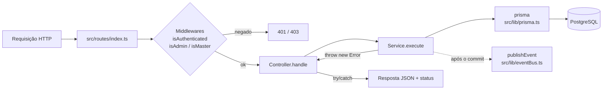
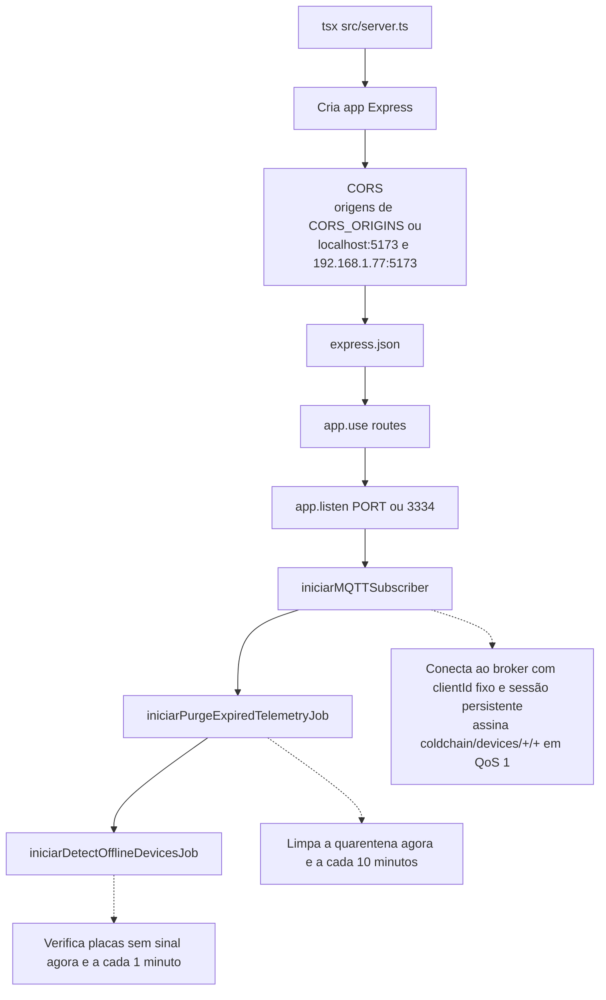
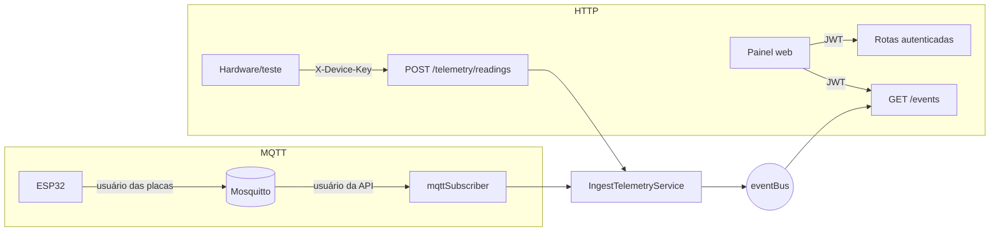

# 1. Arquitetura

## Camadas

Toda requisição HTTP segue o mesmo caminho:

| Camada | Pasta | Responsabilidade |
|---|---|---|
| Rotas | `src/routes/index.ts` | Registra todas as rotas, instancia os controllers e encadeia os middlewares |
| Middlewares | `src/middlewares/` | Autenticação (JWT) e autorização por papel |
| Controllers | `src/controllers/<domínio>/` | Leem `req.params`, `req.query`, `req.body` e `req.user`, chamam o service e convertem erros em status HTTP |
| Services | `src/services/<domínio>/` | Regras de negócio; sinalizam falhas com `throw new Error(mensagem)` |
| Bibliotecas | `src/lib/` | Cliente Prisma, MAC, chave da placa, regra de alertas, barramento de eventos, status de placas, tenant |
| Jobs | `src/jobs/` | Tarefas periódicas: limpeza da quarentena e detecção de placas sem sinal |

### Padrão "uma classe por ação"

Cada operação tem um par controller/service com o mesmo nome, por exemplo `CreateColdUnitController.ts` e `CreateColdUnitService.ts`. Os controllers têm um método `handle(req, res)`; os services têm um único método `execute()`.

Não existe tratador global de erros (a linha `app.use(errorHandler)` está comentada em `server.ts`). Cada controller tem seu próprio `try/catch` e decide o status: em geral `400` para erros de validação/negócio, `404` para buscas, `401` no login e `500` em listagens.

### Convenções técnicas

- **ESM** (`"type": "module"`, resolução `nodenext`): imports relativos usam a extensão `.js`.
- **`verbatimModuleSyntax`**: importações apenas de tipo usam `import type`.
- Comentários e mensagens de erro em português.
- Não há etapa de build: o servidor roda direto com `tsx watch src/server.ts`; a checagem de tipos é feita com `npx tsc --noEmit`.
- Operações que escrevem em várias tabelas usam `prisma.$transaction`. A ingestão e o vínculo de placas também tomam um **lock por placa** (`lockDevice`, ver [Telemetria](08-telemetria.md)).

## Infraestrutura local (`docker-compose.yml`)

O compose tem nome fixo (`name: coldchain_api`), para que os volumes não mudem se a pasta for renomeada.

| Serviço | Imagem | Porta | Função |
|---|---|---|---|
| `postgres` (`meu-postgres`) | `postgres:16` | 5433 → 5432 | Banco de dados |
| `mosquitto` (`coldchain-mosquitto`) | `eclipse-mosquitto:2.0.20` | 1883 | Broker MQTT |

O broker não aceita conexões anônimas. A cada início, `mosquitto/entrypoint.sh` gera o arquivo de senhas e a ACL a partir do `.env`:

| Conta | Variáveis | Permissão |
|---|---|---|
| API | `MQTT_USERNAME` / `MQTT_PASSWORD` | Só **lê** `coldchain/devices/#` |
| Placas (compartilhada) | `MQTT_DEVICE_USERNAME` / `MQTT_DEVICE_PASSWORD` | Só **publica** em `coldchain/devices/#` |

`mosquitto.conf` liga a persistência e enfileira mensagens QoS 0 (`queue_qos0_messages true`, até 100 000). Como a API se conecta com sessão persistente, o broker guarda as leituras enquanto ela estiver fora do ar e as entrega quando ela volta.

## Inicialização do servidor (`src/server.ts`)

1. Cria a aplicação Express.
2. Configura o CORS com `credentials: true` e os métodos `GET, POST, PUT, DELETE, PATCH`. As origens vêm de `CORS_ORIGINS` (separadas por vírgula) ou, na ausência, `http://localhost:5173` e `http://192.168.1.77:5173`.
3. Habilita o parser JSON e registra as rotas.
4. Sobe o servidor HTTP na porta `PORT` (padrão 3334).
5. Inicia o assinante MQTT (ver [Telemetria](08-telemetria.md)).
6. Inicia os jobs de limpeza da quarentena e de placas sem sinal (ver [Jobs](11-jobs-e-soft-delete.md)).

O carregamento do `.env` acontece em `src/lib/prisma.ts` (`import 'dotenv/config'`), importado indiretamente pelas rotas antes de qualquer leitura de `process.env`.

## Conexão com o banco (`src/lib/prisma.ts`)

- Cria um `pg.Pool` com `DATABASE_URL` e o adaptador `PrismaPg`.
- Configura `omit: { coldUnitDevice: { apiKeyHash: true } }`: o hash da chave da placa nunca sai nas respostas. O código que precisa dele pede explicitamente com `omit: { apiKeyHash: false }`.
- Exporta `prisma`, estendido com `$extends` para a exclusão lógica (ver [Jobs e soft delete](11-jobs-e-soft-delete.md)), e o tipo `TransactionClient`, usado pelas funções que rodam dentro de transações.

## Fontes de entrada de dados

