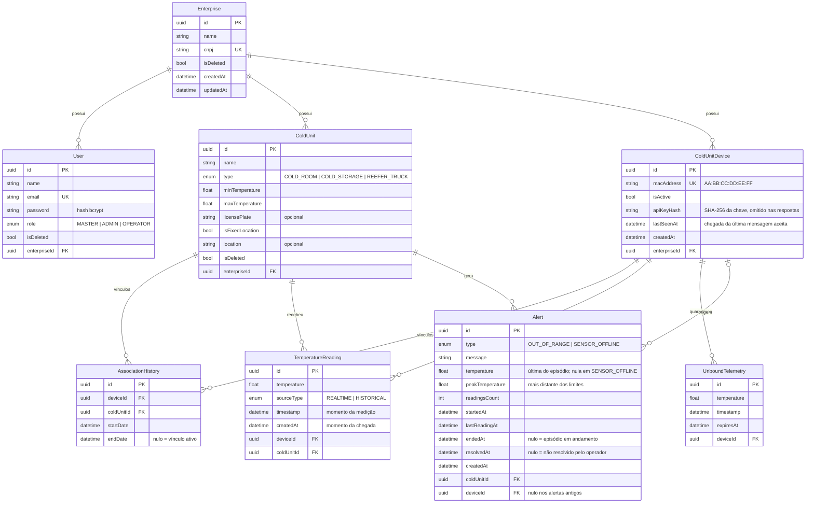

# 2. Modelo de dados

Definido em `api/prisma/schema.prisma`. As tabelas usam nomes em snake_case (`@@map`) e as colunas `DateTime` são `timestamp` **sem fuso horário**, gravadas em UTC.

## Diagrama entidade-relacionamento



## Entidades

### Enterprise (`enterprises`)
Empresa cliente (tenant). O CNPJ é único, inclusive entre empresas excluídas. Possui usuários, unidades frias e placas. Tem exclusão lógica (`is_deleted`).

### User (`users`)
Usuário do painel. E-mail único (também entre excluídos), senha guardada como hash bcrypt, papel `MASTER`, `ADMIN` ou `OPERATOR` (padrão). Pertence a uma empresa. Exclusão lógica.

### ColdUnit (`cold_units`)
Estrutura monitorada: câmara fria (`COLD_ROOM`), frigorífico/armazém (`COLD_STORAGE`) ou caminhão refrigerado (`REEFER_TRUCK`). Guarda a faixa permitida (`min_temperature`/`max_temperature`), placa do veículo, se é fixa e a localização. Exclusão lógica.

### ColdUnitDevice (`cold_unit_devices`)
A placa ESP32. Identificada pelo MAC normalizado (único) e pertencente a uma empresa.
- `api_key_hash`: SHA-256 da chave que a placa envia com as leituras. Nulo significa que a placa ainda não tem chave e seus dados são recusados. O cliente Prisma o omite de todas as respostas.
- `last_seen_at`: hora de **chegada** da última mensagem aceita, inclusive reenvios e dados que foram para a quarentena. É o "visto por último" usado no painel e na detecção de placas sem sinal.
- `is_active`: a placa pode ser desativada. **Não** tem exclusão lógica: a desativação substitui a exclusão.

### AssociationHistory (`association_history`)
Vínculo entre placa e unidade, com período (`start_date`, `end_date`). `end_date` nulo indica o vínculo vigente. Mantém o histórico de onde cada placa esteve, o que permite atribuir leituras antigas (store & forward) à unidade correta.

- **Índice único parcial** criado manualmente na migration `20261030092030_device_association`:
  ```sql
  CREATE UNIQUE INDEX "association_history_active_device_key"
    ON "association_history"("device_id") WHERE "end_date" IS NULL;
  ```
  Garante no banco que uma placa tenha no máximo um vínculo ativo. O Prisma não consegue expressar esse índice no `schema.prisma`.
- Uma unidade pode ter várias placas ativas ao mesmo tempo.
- O `BindDeviceService` garante que dois vínculos da mesma placa nunca cubram o mesmo horário (ver [Placas e vínculos](07-placas-e-vinculos.md)).

### TemperatureReading (`temperature_readings`)
Leitura oficial, já atribuída a uma unidade. `timestamp` é o momento da medição; `created_at` é o momento em que chegou ao servidor. `source_type` indica se veio em tempo real (`REALTIME`) ou de envio atrasado/recuperado (`HISTORICAL`).

- **Único em `(device_id, timestamp)`**: uma placa não mede duas vezes no mesmo instante, então um reenvio do store & forward é ignorado (`skipDuplicates`).
- Índice em `(cold_unit_id, timestamp)` para consultas por período.

### UnboundTelemetry (`unbound_telemetry`)
Quarentena: leituras de placas cadastradas que ainda não estão vinculadas a nenhuma unidade no horário da medição. `expires_at` = hora de chegada + `QUARANTINE_TTL_HOURS` (padrão 2 h). Também é única em `(device_id, timestamp)` e tem índice em `expires_at` para a limpeza periódica.

### Alert (`alerts`)
Um alerta é um **episódio**, não uma leitura:
- `OUT_OF_RANGE`: leituras seguidas de uma placa, numa unidade, fora dos limites. Guarda a última temperatura, o pico (a leitura mais distante dos limites), a quantidade de leituras, o início, a última leitura e o fim (`ended_at`, nulo enquanto continua).
- `SENSOR_OFFLINE`: período em que uma placa vinculada ficou sem enviar dados. Não tem temperatura e tem `readings_count = 0`.

`resolved_at` é a ação do operador ("resolvido"), independente de `ended_at` (o episódio acabou). Alertas criados antes dos episódios têm `device_id` nulo. Índice em `(cold_unit_id, device_id, started_at)`. Detalhes em [Alertas](09-alertas.md).

## Exclusões em cascata (banco)

| Relação | onDelete |
|---|---|
| AssociationHistory → ColdUnitDevice / ColdUnit | Cascade |
| TemperatureReading → ColdUnit | Cascade |
| UnboundTelemetry → ColdUnitDevice | Cascade |
| Alert → ColdUnit | Cascade |
| Alert → ColdUnitDevice | Set null |

Na prática essas cascatas não disparam, porque empresas, usuários e unidades nunca são apagados fisicamente (soft delete) e placas são apenas desativadas.

## Histórico de migrations

| Migration | Conteúdo |
|---|---|
| `20261020095128_init_leituras` | Protótipo: tabela `leituras_temperatura` sem vínculo com unidades |
| `20261024191157_migrate_creation_fulldatabase` | Empresas, usuários, unidades, alertas e leituras |
| `20261030085906_telemetry_iot_association` | Rascunho: coluna `not_fixed` e tabela `ColdUnitDevice` (desfeitos na migration seguinte) |
| `20261030092030_device_association` | Placas, histórico de vínculos, quarentena, `device_id` nas leituras e o índice único parcial |
| `20261108120000_alert_episodes` | Remove leituras repetidas e cria os índices únicos `(device_id, timestamp)`; alertas viram episódios (os antigos ficam encerrados na própria leitura) |
| `20261108180000_device_key_last_seen` | `api_key_hash` e `last_seen_at` nas placas, preenchendo o último contato a partir dos dados existentes |
| `20261108210000_sensor_offline_alerts` | Enum `AlertType` e alertas sem temperatura (`SENSOR_OFFLINE`) |
