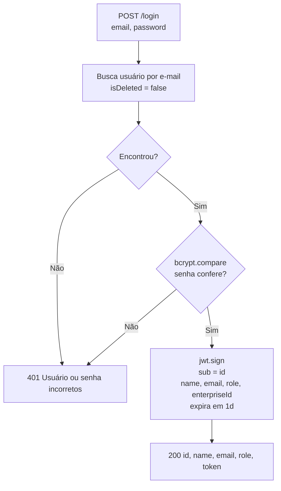
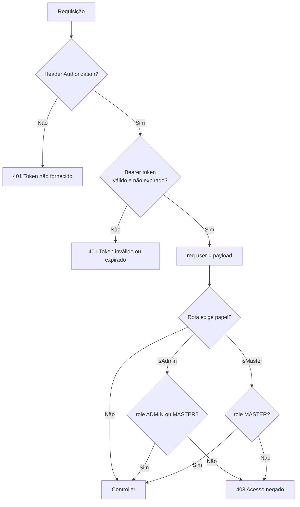
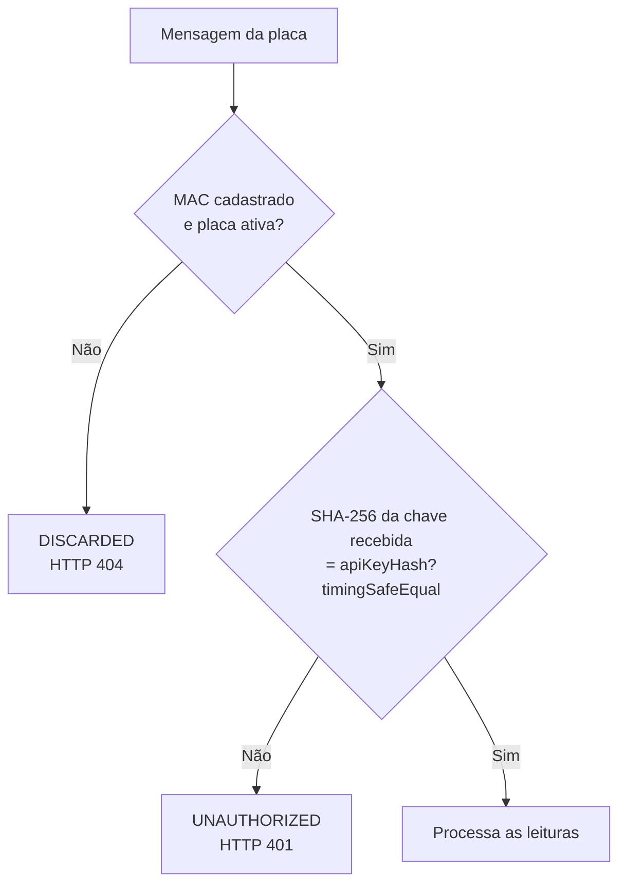
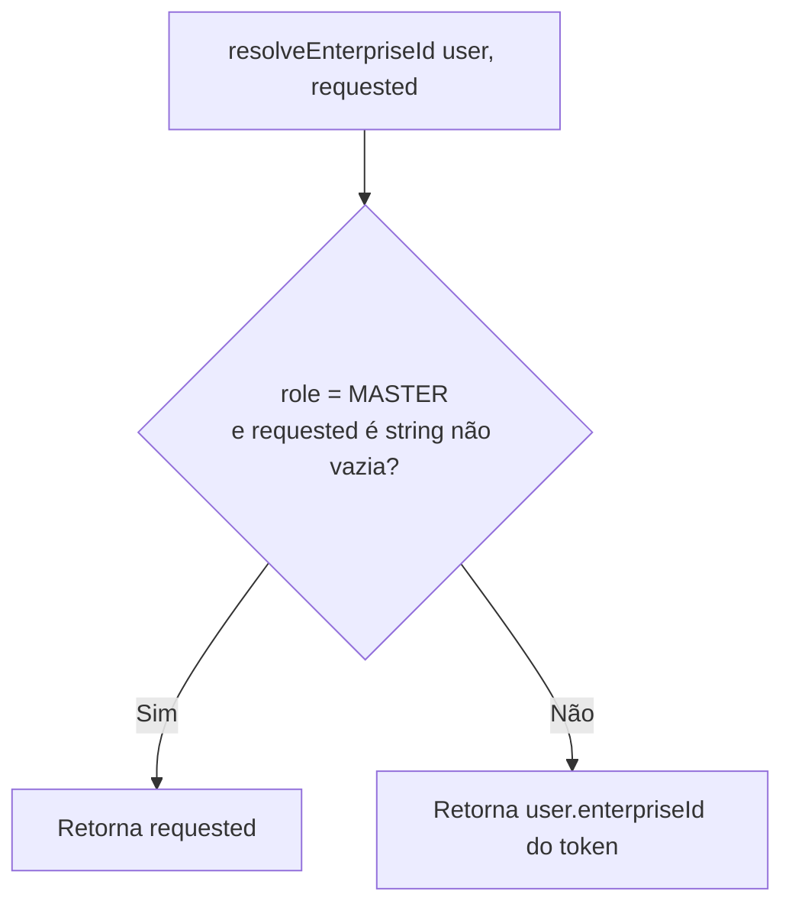

# 3. Autenticação e permissões

## Login — `POST /login`

Arquivos: `src/controllers/user/AuthUserController.ts`, `src/services/user/AuthUserService.ts`

**Corpo:** `{ "email": string, "password": string }`

**Regras:**
1. Busca o usuário pelo e-mail com `isDeleted: false` (usuários excluídos não entram).
2. Compara a senha com o hash usando `bcryptjs.compare`.
3. Em qualquer falha a mensagem é a mesma — "Usuário ou senha incorretos." — para não revelar se o e-mail existe.
4. Gera um JWT assinado com `JWT_SECRET`, validade de **1 dia**, com `sub` = id do usuário e payload `{ name, email, role, enterpriseId }`.

**Respostas:**
| Status | Corpo |
|---|---|
| 200 | `{ id, name, email, role, token }` |
| 401 | `{ error: "Usuário ou senha incorretos." }` |

## Middleware `isAuthenticated`

Arquivo: `src/middlewares/isAuthenticated.ts`

1. Lê o cabeçalho `Authorization`. Ausente → `401 "Token não fornecido."`.
2. Separa o formato `Bearer <token>`. Sem token → `401 "Token inválido ou expirado."`.
3. Verifica a assinatura e a validade com `jwt.verify` e `JWT_SECRET`. Falha (ou `JWT_SECRET` ausente) → `401 "Token inválido ou expirado."`.
4. Preenche `req.user = { id, name, email, role, enterpriseId }` com os dados do token e chama `next()`.

O token **não é conferido com o banco**: se o usuário for excluído ou tiver o papel alterado, o token antigo continua válido até expirar (1 dia).

## Middlewares de papel

| Middleware | Arquivo | Permite | Erro |
|---|---|---|---|
| `isAdmin` | `src/middlewares/isAdmin.ts` | `ADMIN` e `MASTER` | 403 "Acesso Negado: Apenas administradores podem realizar esta ação." |
| `isMaster` | `src/middlewares/isMaster.ts` | Só `MASTER` | 403 "Acesso Negado: Apenas administradores globais (MASTER) podem realizar esta ação." |

Ambos dependem de `req.user`, então sempre rodam depois de `isAuthenticated`.

## Autenticação das placas

O hardware não usa JWT. Cada placa tem uma **chave própria** (`src/lib/deviceKey.ts`):

1. `generateDeviceKey()` gera `ck_` + 24 bytes aleatórios em base64url.
2. O banco guarda só `hashDeviceKey(chave)` (SHA-256) em `ColdUnitDevice.apiKeyHash`. Como a chave é aleatória e longa, SHA-256 basta, sem o custo do bcrypt a cada leitura.
3. A chave em texto aparece **uma única vez**, na resposta de `POST /devices` (cadastro) ou de `POST /devices/:id/key` (nova chave, que invalida a anterior). Ela vai para o `secrets.h` do firmware.
4. A placa envia a chave em toda mensagem: no campo `key` do payload MQTT ou no header `X-Device-Key` do HTTP.
5. `verifyDeviceKey` compara os hashes com `timingSafeEqual` (tempo constante). Placa sem chave (`apiKeyHash` nulo) tem os dados recusados.

O MAC sozinho não autentica: ele está impresso no QR Code e aparece no tópico MQTT. A chave é o que prova que a mensagem veio da placa.

No broker há uma segunda camada: as placas entram com uma conta **compartilhada** (`MQTT_DEVICE_USERNAME`), que só pode publicar em `coldchain/devices/#`, e a API com outra, que só pode ler (ver [Arquitetura](01-arquitetura.md)).

## Papéis

| Ação | OPERATOR | ADMIN | MASTER |
|---|:-:|:-:|:-:|
| Ver dashboard, unidades, leituras, alertas, placas | ✔ | ✔ | ✔ |
| Resolver alertas | ✔ | ✔ | ✔ |
| Vincular/desvincular placa (QR Code) | ✔ | ✔ | ✔ |
| Editar o próprio perfil e senha | ✔ | ✔ | ✔ |
| Criar/editar/excluir unidades frias | | ✔ | ✔ |
| Criar/editar/excluir usuários da empresa | | ✔ | ✔ |
| Gerenciar empresas | | | ✔ |
| Cadastrar, desativar e reativar placas, gerar nova chave | | | ✔ |
| Receber eventos em tempo real (`GET /events`) | ✔ (só a própria empresa) | ✔ (só a própria empresa) | ✔ (todas) |
| Agir sobre outra empresa (usuários, listagem de placas) | | | ✔ |

O papel `MASTER` não pode ser atribuído pela API: só `ADMIN` e `OPERATOR` são aceitos na criação/edição de usuários. O MASTER inicial vem do seed.

## Multiempresa (tenancy)

Cada usuário pertence a uma empresa, e o `enterpriseId` do token é usado para isolar os dados. Esse filtro é aplicado **em cada service** (não há um filtro central): as consultas incluem `enterpriseId` diretamente (unidades, placas, usuários) ou por relação (`coldUnit: { enterpriseId }` em alertas, `device: { enterpriseId }` em quarentena e desvínculos).

### `resolveEnterpriseId` (`src/lib/tenant.ts`)

Usado nas rotas em que o MASTER pode atuar sobre outra empresa (`/users` e `GET /devices`):

Para ADMIN e OPERATOR o valor enviado é ignorado, então não há como acessar outra empresa alterando a requisição.

A empresa enviada pelo cliente vem de:
- `req.body.enterpriseId` em `POST /users`;
- `req.query.enterpriseId` em `GET /users`, `PUT /users/:id`, `DELETE /users/:id` e `GET /devices`.

As demais rotas usam sempre a empresa do token, inclusive para o MASTER.
