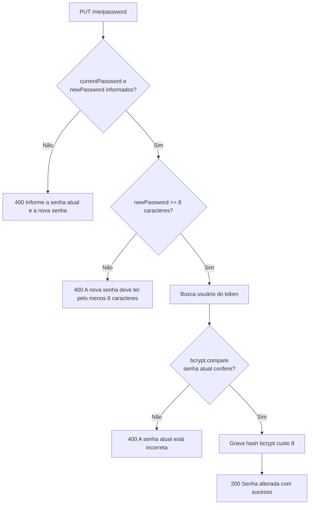
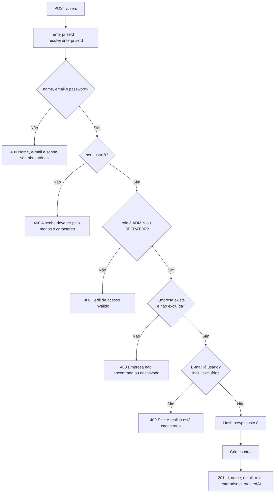
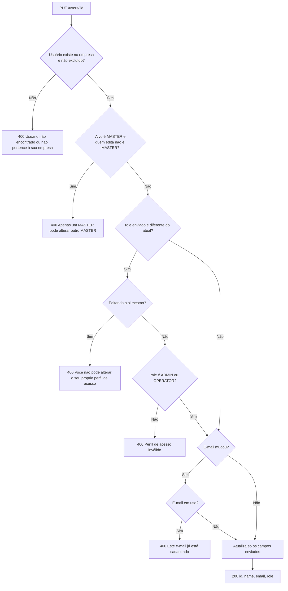

# 4. Usuários

Pasta: `src/controllers/user/` e `src/services/user/`. O login está em [Autenticação](03-autenticacao-e-permissoes.md).

Nenhuma resposta retorna o campo `password`: todos os services usam `select` com os campos permitidos.

---

## 4.1 Ver o próprio usuário — `GET /me`

`CurrentUserController` → `CurrentUserService`

- Usa `req.user.id` do token.
- Busca o usuário não excluído e retorna `{ id, name, email, role, enterpriseId, createdAt }`.

| Status | Quando |
|---|---|
| 200 | Usuário encontrado |
| 404 | "Usuário não encontrado." (ex.: excluído com token ainda válido) |

---

## 4.2 Editar o próprio perfil — `PUT /me`

`UpdateProfileController` → `UpdateProfileService`

**Corpo:** `{ name?, email? }` (papel e empresa não podem ser alterados aqui)

1. Busca o usuário pelo id do token.
2. Se o e-mail mudou, verifica com `findUnique` se já está em uso — `findUnique` enxerga usuários excluídos, então o e-mail de um usuário excluído continua reservado.
3. Atualiza só os campos enviados.

| Status | Quando |
|---|---|
| 200 | Perfil atualizado |
| 400 | "Usuário não encontrado." / "Este e-mail já está cadastrado." |

---

## 4.3 Trocar a própria senha — `PUT /me/password`

`ChangePasswordController` → `ChangePasswordService`

**Corpo:** `{ currentPassword, newPassword }`

---

## 4.4 Criar usuário — `POST /users` (ADMIN, MASTER)

`CreateUserController` → `CreateUserService`

**Corpo:** `{ name, email, password, role?, enterpriseId? }`
- `role` padrão: `OPERATOR`. Aceita apenas `ADMIN` ou `OPERATOR`.
- `enterpriseId` só é considerado se quem cria for MASTER (`resolveEnterpriseId`); para o ADMIN, o usuário é criado na própria empresa.

---

## 4.5 Listar usuários — `GET /users` (ADMIN, MASTER)

`ListUsersController` → `ListUsersService`

- Query opcional `?enterpriseId=` (só vale para o MASTER).
- Retorna os usuários não excluídos da empresa, em ordem alfabética: `{ id, name, email, role, createdAt }`.

---

## 4.6 Editar usuário — `PUT /users/:id` (ADMIN, MASTER)

`UpdateUserController` → `UpdateUserService`

**Corpo:** `{ name?, email?, role? }` — **Query:** `?enterpriseId=` (MASTER)

---

## 4.7 Excluir usuário — `DELETE /users/:id` (ADMIN, MASTER)

`DeleteUserController` → `DeleteUserService`

1. Não permite excluir a si mesmo.
2. O usuário precisa existir na empresa resolvida e não estar excluído.
3. Só um MASTER exclui outro MASTER.
4. Executa `prisma.user.delete`, que a extensão transforma em `isDeleted = true` (soft delete).

| Status | Quando |
|---|---|
| 200 | `{ message: "Usuário removido com sucesso." }` |
| 400 | "Você não pode excluir o seu próprio usuário." / "Usuário não encontrado ou não pertence à sua empresa." / "Apenas um MASTER pode excluir outro MASTER." |

O usuário excluído não consegue mais fazer login, mas um token emitido antes da exclusão segue válido até expirar.
