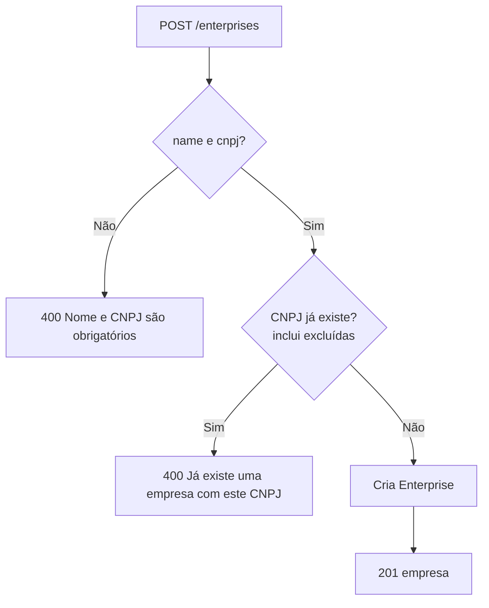
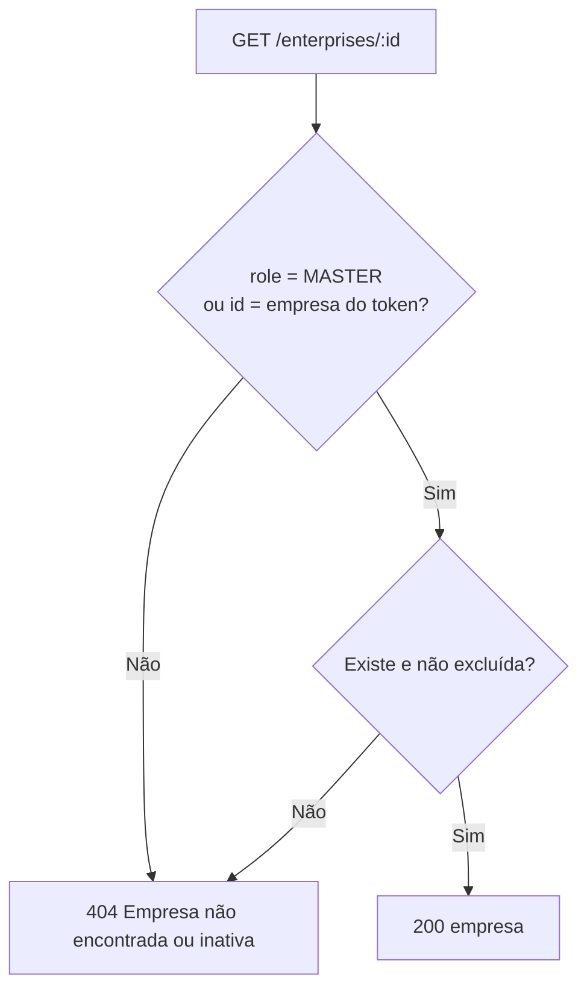
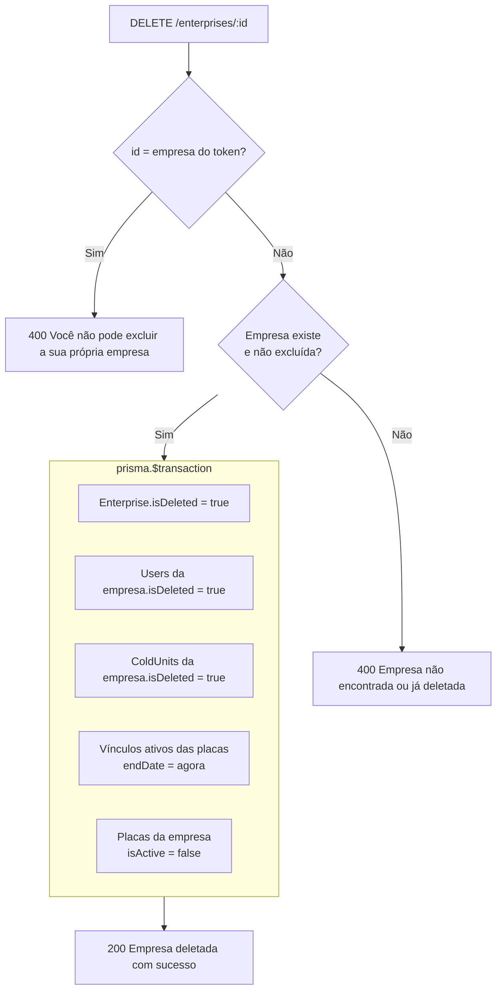

# 5. Empresas

Pasta: `src/controllers/enterprise/` e `src/services/enterprise/`. Todas as rotas exigem autenticação; criar, listar, editar e excluir exigem `MASTER`.

---

## 5.1 Criar empresa — `POST /enterprises` (MASTER)

**Corpo:** `{ name, cnpj }`

1. Nome e CNPJ obrigatórios.
2. Verifica duplicidade de CNPJ com `findUnique`, que inclui empresas excluídas: um CNPJ nunca é reaproveitado.
3. Cria a empresa.

| Status | Quando |
|---|---|
| 201 | Empresa criada |
| 400 | "Nome e CNPJ são obrigatórios." / "Já existe uma empresa cadastrada com este CNPJ." |

---

## 5.2 Listar empresas — `GET /enterprises` (MASTER)

Retorna as empresas não excluídas em ordem alfabética. Erro inesperado → `500 "Erro interno ao listar empresas."`.

---

## 5.3 Consultar empresa — `GET /enterprises/:id`

- MASTER consulta qualquer empresa.
- Os demais papéis só a própria: se o `id` for de outra empresa, o controller responde `404` sem consultar o banco, para não revelar se ela existe.
- Empresa excluída ou inexistente → `404 "Empresa não encontrada ou inativa."`.

---

## 5.4 Editar empresa — `PUT /enterprises/:id` (MASTER)

**Corpo:** `{ name?, cnpj? }`

1. A empresa precisa existir e não estar excluída.
2. Se o CNPJ mudou, verifica se está em uso por outra empresa (inclusive excluída).
3. Campos vazios ou ausentes mantêm o valor atual (`name || enterprise.name`).

| Status | Quando |
|---|---|
| 200 | Empresa atualizada |
| 400 | "Empresa não encontrada." / "Este CNPJ já está em uso por outra empresa." |

---

## 5.5 Excluir empresa — `DELETE /enterprises/:id` (MASTER)

O MASTER não pode excluir a própria empresa (isso o excluiria junto). A exclusão é lógica e afeta tudo o que pertence à empresa, numa única transação:

Consequências:
- Os usuários da empresa deixam de conseguir fazer login.
- As placas passam a ter a telemetria descartada (placa inativa).
- O histórico (leituras, alertas, vínculos) permanece no banco.

A transação usa `update`/`updateMany` com `isDeleted: true` em vez de `delete`, porque o `delete` da extensão de soft delete roda fora da transação.
