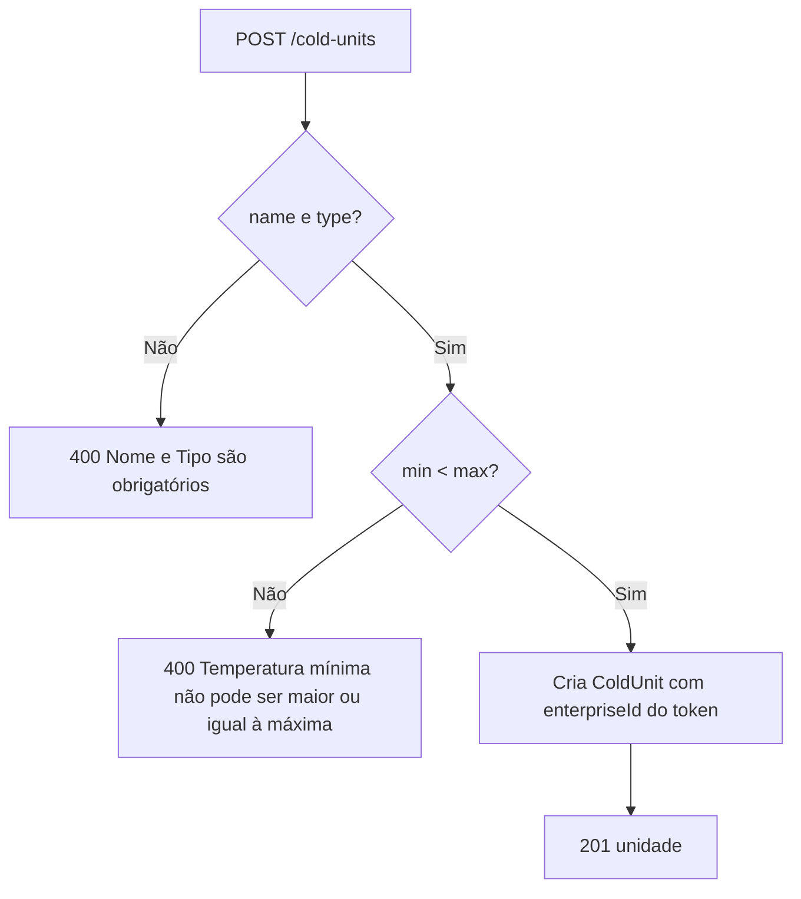
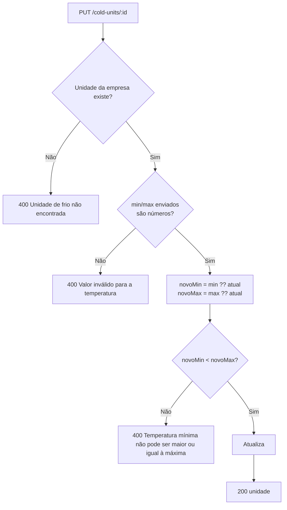
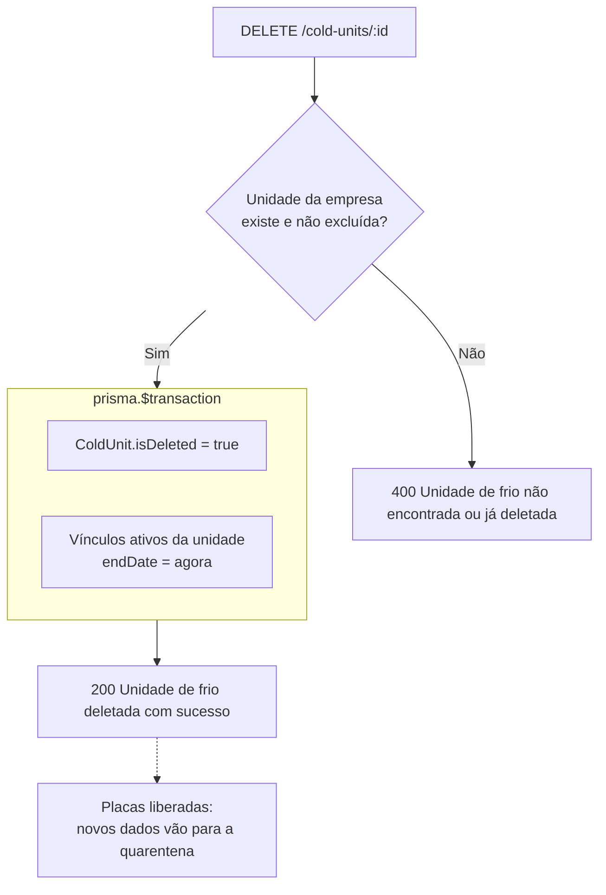

# 6. Unidades frias (Cold Units)

Pasta: `src/controllers/coldUnit/` e `src/services/coldUnit/`. Uma unidade fria é a estrutura monitorada: câmara fria (`COLD_ROOM`), frigorífico/armazém (`COLD_STORAGE`) ou caminhão refrigerado (`REEFER_TRUCK`).

Todas as rotas usam a empresa do token (`req.user.enterpriseId`), inclusive para o MASTER.

---

## 6.1 Criar unidade — `POST /cold-units` (ADMIN, MASTER)

**Corpo:**
```json
{
  "name": "Câmara 01",
  "type": "COLD_ROOM",
  "minTemperature": 2,
  "maxTemperature": 8,
  "licensePlate": "ABC1D23",
  "isFixedLocation": true,
  "location": "Galpão A"
}
```

1. `name` e `type` obrigatórios.
2. `minTemperature` precisa ser menor que `maxTemperature`.
3. Cria a unidade na empresa do usuário. Campos opcionais ausentes viram `null` (`licensePlate`, `location`) ou `false` (`isFixedLocation`).



---

## 6.2 Listar unidades — `GET /cold-units`

Retorna as unidades não excluídas da empresa em ordem alfabética. Erro → `500 "Erro interno ao listar unidades de frio."`.

## 6.3 Consultar unidade — `GET /cold-units/:id`

Busca por `id` + empresa do token. Não encontrada → `404 "Unidade de frio não encontrada ou inativa."`.

---

## 6.4 Editar unidade — `PUT /cold-units/:id` (ADMIN, MASTER)

**Corpo:** qualquer subconjunto dos campos da criação.

1. A unidade precisa existir na empresa.
2. `minTemperature`/`maxTemperature`, se enviados, precisam ser números.
3. A faixa final (valores novos combinados com os atuais) precisa ter `min < max`.
4. Regras de atualização:
   - `name`, `type`: vazio/ausente mantém o atual.
   - `licensePlate`, `location`: ausente mantém; `null` ou `""` limpa.
   - `isFixedLocation`: ausente mantém.

A mudança de limites vale para as leituras seguintes: alertas já gerados não são recalculados.



---

## 6.5 Excluir unidade — `DELETE /cold-units/:id` (ADMIN, MASTER)

Exclusão lógica em transação:
1. `ColdUnit.isDeleted = true`.
2. Encerra os vínculos ativos com a unidade (`endDate = agora`).

Como as placas ficam sem vínculo, as próximas leituras delas vão para a **quarentena** e podem ser vinculadas a outra unidade pelo QR Code. Um alerta de placa sem sinal aberto para a unidade é encerrado pelo job de placas sem sinal na execução seguinte (ver [Alertas](09-alertas.md)).



---

## 6.6 Histórico de placas da unidade — `GET /cold-units/:id/associations`

Retorna todos os vínculos (ativos e encerrados) da unidade, do mais recente para o mais antigo, com `device: { id, macAddress }`. Unidade inexistente na empresa → `404`.

Exemplo de resposta:
```json
[
  {
    "id": "…",
    "deviceId": "…",
    "coldUnitId": "…",
    "startDate": "2026-10-30T12:00:00.000Z",
    "endDate": null,
    "device": { "id": "…", "macAddress": "24:6F:28:AA:BB:CC" }
  }
]
```
