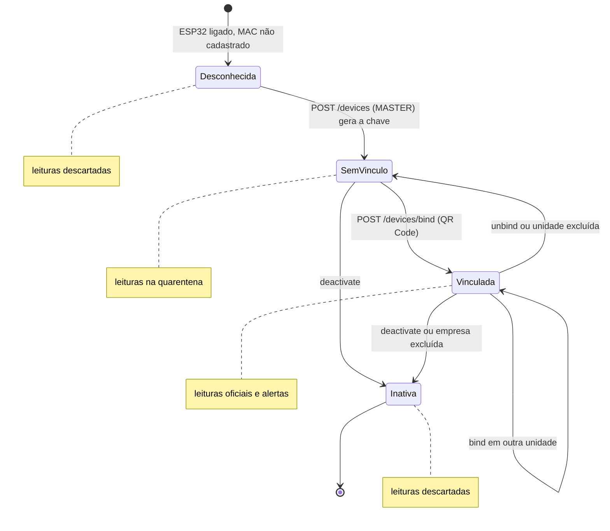
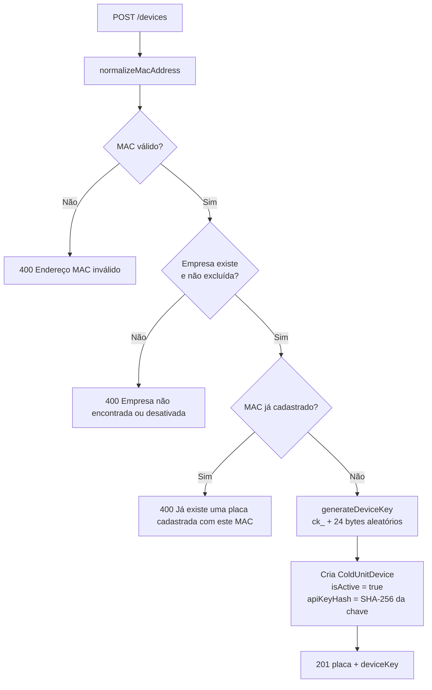
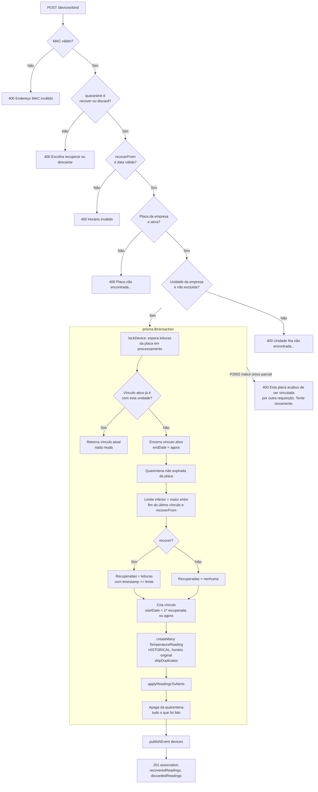

# 7. Placas e vínculos (Cold Unit Devices)

Pasta: `api/src/controllers/device/` e `api/src/services/device/`.

Uma **placa** (`ColdUnitDevice`) é um ESP32 identificado pelo endereço MAC e autenticado por uma chave própria. Ela pertence a uma empresa e pode ser **vinculada** a uma unidade fria. O vínculo é registrado em `AssociationHistory` com início e fim, então a placa pode mudar de unidade sem perder o histórico.

## Ciclo de vida da placa



Em qualquer estado ativo, uma mensagem com chave errada é recusada.

## Normalização do MAC (`src/lib/macAddress.ts`)

`normalizeMacAddress(valor)`:
1. Rejeita valores que não são string.
2. Remove `:`, `-`, `.` e espaços e converte para maiúsculas.
3. Exige exatamente 12 dígitos hexadecimais.
4. Retorna no formato `AA:BB:CC:DD:EE:FF`, ou `null` se inválido.

Assim, `24-6f-28-aa-bb-cc`, `246F28AABBCC` e `24:6F:28:AA:BB:CC` representam a mesma placa. É usada no cadastro, no vínculo e na ingestão (inclusive no MAC extraído do tópico MQTT).

---

## 7.1 Cadastrar placa — `POST /devices` (MASTER)

`CreateDeviceController` → `CreateDeviceService`

**Corpo:** `{ "macAddress": "24:6F:28:AA:BB:CC", "enterpriseId": "<uuid>" }`

O MASTER cadastra a placa e define a empresa dona (o `enterpriseId` vem do corpo, sem `resolveEnterpriseId`, porque a rota já é exclusiva do MASTER).



A resposta traz a placa e o campo `deviceKey`, **a única vez em que a chave aparece**. Ela deve ser colada no portal de configuração da placa (rede `ColdChain-XXXXXX`; ver `firmware/README.md`). A placa nasce ativa e sem vínculo: a partir daqui, as leituras com a chave certa deixam de ser descartadas e passam a ir para a quarentena.

## 7.2 Gerar nova chave — `POST /devices/:id/key` (MASTER)

`RotateDeviceKeyController` → `RotateDeviceKeyService`

Gera outra chave e grava o novo hash; a anterior deixa de valer imediatamente. Resposta `201 { deviceId, macAddress, deviceKey }`. Placa inexistente → `400 "Placa não encontrada."`. Serve para chave perdida, suspeita de vazamento ou para placas cadastradas antes da existência das chaves (que têm `apiKeyHash` nulo e não conseguem enviar dados).

---

## 7.3 Listar placas — `GET /devices`

`ListDevicesController` → `ListDevicesService`

**Query:** `?enterpriseId=` (só o MASTER), `?includeInactive=true` (inclui desativadas).

Para cada placa retorna (nunca o hash da chave):
- dados da placa, inclusive `lastSeenAt`, e o vínculo atual (`associations` com `endDate = null`, incluindo `coldUnit { id, name, type }`);
- `isOnline`: placa ativa e com `lastSeenAt` nos últimos `SENSOR_OFFLINE_MINUTES` (padrão 10);
- `offlineThresholdMinutes`.

`lastSeenAt` é a hora de **chegada** da última mensagem aceita, gravada pela ingestão. Vale também para leituras antigas, repetidas ou em quarentena, porque qualquer mensagem aceita prova que a placa está viva agora.

---

## 7.4 Placas aguardando vínculo — `GET /devices/unbound`

`ListUnboundDevicesService`

Agrupa a quarentena não expirada (`expiresAt > agora`) das placas da empresa do token e retorna, por placa:

```json
[
  {
    "deviceId": "…",
    "macAddress": "24:6F:28:AA:BB:CC",
    "pendingReadings": 42,
    "firstReadingAt": "2026-11-11T11:10:00.000Z",
    "lastReadingAt": "2026-11-11T13:10:00.000Z",
    "nextExpirationAt": "2026-11-11T13:15:00.000Z"
  }
]
```

O painel usa isso para mostrar placas ligadas que ainda não foram associadas a uma unidade, o período coberto pelas leituras retidas e quando as mais antigas expiram.

---

## 7.5 Vincular placa (QR Code) — `POST /devices/bind`

`BindDeviceController` → `BindDeviceService`

**Corpo:**
```json
{
  "macAddress": "<lido do QR Code>",
  "coldUnitId": "<uuid>",
  "quarantine": "recover",
  "recoverFrom": "2026-11-11T12:00:00Z"
}
```

| Campo | Obrigatório | Significado |
|---|---|---|
| `macAddress` | Sim | MAC lido do QR Code impresso na placa |
| `coldUnitId` | Sim | Unidade escolhida |
| `quarantine` | Não (padrão `recover`) | `recover`: as leituras retidas viram oficiais nesta unidade. `discard`: são apagadas, por exemplo quando a placa mediu na bancada antes da instalação |
| `recoverFrom` | Não | Com `recover`, recupera só as leituras a partir deste horário |

Qualquer usuário autenticado (inclusive OPERATOR) pode vincular, desde que placa e unidade sejam da empresa do token.



Detalhes:
- **Reescanear na mesma unidade** não cria histórico e não mexe na quarentena.
- **Sem sobreposição de vínculos**: nada anterior ao fim do último vínculo da placa é recuperado. Assim, dois vínculos nunca cobrem o mesmo horário e uma leitura nunca poderia pertencer a duas unidades.
- **Início do vínculo**: é o horário da primeira leitura recuperada (ou agora, se nada for recuperado). Assim, um dado atrasado do mesmo período que chegue depois cai nesta unidade, em vez de voltar para a quarentena.
- **Resgate**: as leituras recuperadas passam a pertencer à unidade como `HISTORICAL`, com o horário de medição original, e passam pela regra de episódios de alerta com os limites dessa unidade.
- **Descarte**: as leituras não recuperadas (por `discard`, por `recoverFrom` ou por serem anteriores ao último vínculo) são apagadas da quarentena; a resposta informa quantas em `discardedReadings`.
- **Concorrência**: o `lockDevice` (advisory lock do PostgreSQL por placa) faz uma leitura que esteja chegando esperar o fim do vínculo, e vice-versa; uma leitura que chega depois já encontra o vínculo novo. Dois binds simultâneos da mesma placa violariam o índice único parcial; o Prisma lança `P2002` e o service devolve uma mensagem amigável.
- Depois do commit, publica um evento `devices` para as telas abertas (ver [Tempo real](14-tempo-real.md)).

---

## 7.6 Desvincular placa — `POST /devices/:id/unbind`

`UnbindDeviceService`

Encerra (`endDate = agora`) o vínculo ativo da placa, filtrando pela empresa do token através da relação `device: { enterpriseId }`. Se nenhum vínculo for encerrado → `400 "Vínculo ativo não encontrado para esta placa."`. Sucesso → `200 { message: "Placa desvinculada com sucesso." }` e evento `devices`.

Depois disso, as leituras da placa voltam para a quarentena, e um alerta de placa sem sinal aberto para o vínculo é encerrado pelo job.

---

## 7.7 Desativar placa — `PATCH /devices/:id/deactivate` (MASTER)

`DeactivateDeviceService`

Em transação: `isActive = false` e encerra o vínculo ativo. O histórico de leituras e vínculos é mantido; a placa só deixa de aceitar dados e novos vínculos. Placa inexistente ou já inativa → `400 "Placa não encontrada ou já desativada."`. Publica um evento `devices`.

Não existe rota para reativar uma placa.

---

## 7.8 Histórico de vínculos da placa — `GET /devices/:id/associations`

Retorna os vínculos da placa (mais recente primeiro) com `coldUnit { id, name, type }`. A placa precisa ser da empresa do token, senão `404 "Placa não encontrada ou não pertence à sua empresa."`.
