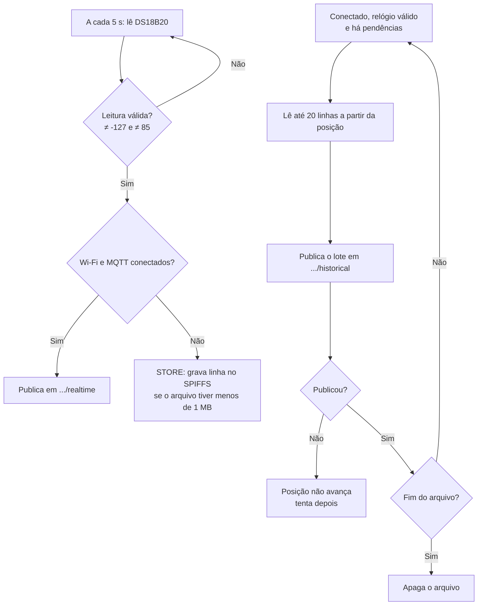
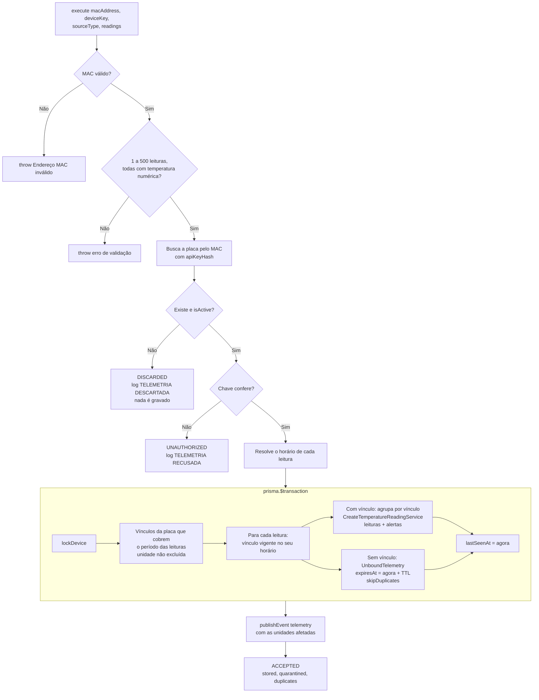
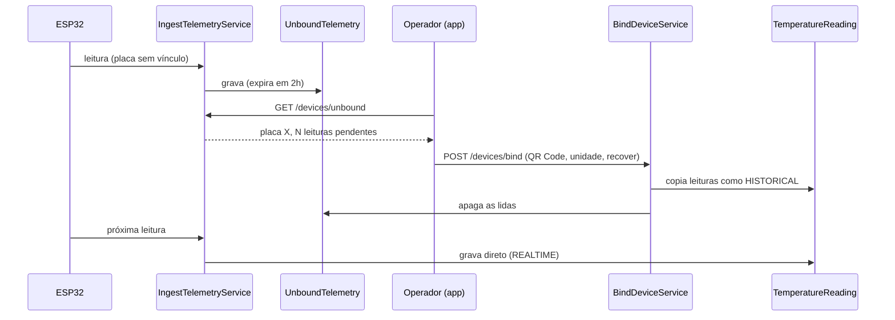
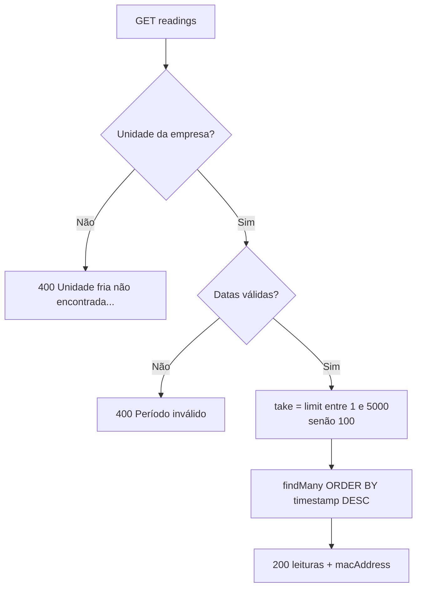
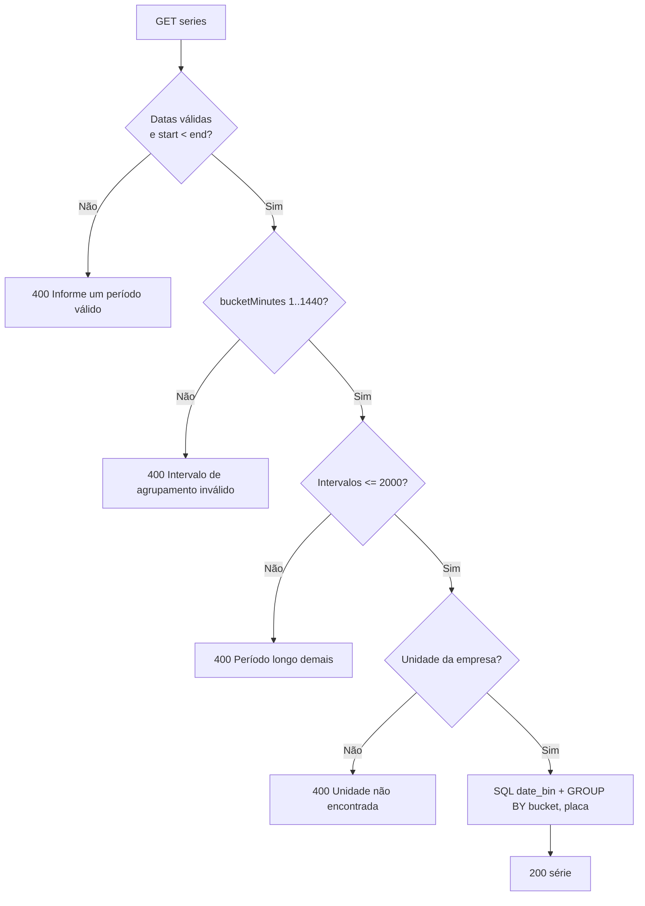

# 8. Telemetria

A telemetria é o coração do sistema: recebe as temperaturas medidas pelas placas, decide para onde cada leitura vai e permite consultá-las depois.

Arquivos principais (em `api/src/`):
- `services/mqtt/mqttSubscriber.ts`: entrada via MQTT
- `controllers/telemetry/CreateTemperatureReadingController.ts`: entrada via HTTP
- `services/telemetry/IngestTelemetryService.ts`: ponto único de decisão
- `services/telemetry/CreateTemperatureReadingService.ts`: grava as leituras oficiais e atualiza os alertas
- `lib/temperatureAlerts.ts`: `lockDevice` e a regra de episódios de alerta
- `services/telemetry/ListTemperatureReadingsService.ts` e `ListTemperatureSeriesService.ts`: consultas

---

## 8.1 Lado do hardware (firmware ESP32)

Pasta `firmware/` do monorepo (`src/main.cpp`).

- Sensor DS18B20 lido a cada **5 segundos**. Leituras `-127` (sensor desconectado) e `85` (falha de conversão) são ignoradas.
- O relógio vem do NTP (`pool.ntp.org`, `time.google.com`) em UTC. Datas anteriores a nov/2023 indicam que o NTP ainda não sincronizou.
- Conecta ao Mosquitto com a conta compartilhada das placas e `clientId` estável (`coldchain-<MAC>`).
- **Online**: publica cada leitura em `coldchain/devices/<MAC>/realtime`.
- **Offline (store)**: grava a leitura em `/offline_v2.jsonl` na flash (SPIFFS), com `epoch` (ou 0 sem relógio), `uptime` e `bootId`, até ~1 MB (cerca de 20 h de leituras). Acima disso, novas leituras são descartadas.
- **Reconexão (forward)**: com o relógio válido, envia o arquivo em **lotes de 20 leituras** para `coldchain/devices/<MAC>/historical`, um lote a cada 200 ms, intercalado com as leituras ao vivo. A posição no arquivo só avança se o lote for publicado. Leituras gravadas sem relógio são datadas por `uptime` se forem do mesmo boot; se forem de outro boot, são descartadas por não terem data confiável. Depois de um reboot o envio recomeça do início, e a API ignora o que já recebeu.

Payloads:
```json
{ "key": "ck_...", "temperatura": 4.2, "timestamp": "2026-11-11T12:00:00Z" }
```
```json
{ "key": "ck_...", "leituras": [ { "temperatura": 4.2, "timestamp": "2026-11-11T11:00:00Z" }, ... ] }
```
O `timestamp` é omitido quando a placa não tem relógio válido. O MAC não vai no payload: ele está no tópico.



---

## 8.2 Entrada via MQTT

`iniciarMQTTSubscriber()` é chamado no `server.ts`:

1. Conecta ao broker `MQTT_BROKER_URL` (padrão `mqtt://localhost:1883`) com `MQTT_USERNAME`/`MQTT_PASSWORD`, `clientId` fixo (`MQTT_CLIENT_ID`, padrão `coldchain-api`) e `clean: false`. Essa **sessão persistente** faz o broker guardar as mensagens enquanto a API estiver fora do ar.
2. Assina `coldchain/devices/+/+` em QoS 1.
3. Para cada mensagem, separa o tópico em `coldchain/devices/<MAC>/<canal>`:
   - `realtime` → `sourceType = REALTIME`;
   - `historical` → `sourceType = HISTORICAL`;
   - outro canal → a mensagem é ignorada.
4. Faz `JSON.parse` do payload e monta as leituras: o array `leituras` ou o próprio payload (uma leitura). `temperatura` em texto é convertida com `parseFloat`.
5. Chama `IngestTelemetryService.execute({ macAddress, deviceKey: payload.key, sourceType, readings })`.
6. Registra no console `[MQTT] <MAC> <canal>: N gravada(s), N em quarentena, N repetida(s)`. Erros (JSON inválido, validação) são apenas logados: a placa publica em QoS 0 e não recebe resposta.

## 8.3 Entrada via HTTP — `POST /telemetry/readings`

Sem JWT. A chave da placa vai no header **`X-Device-Key`**.

**Corpo**, uma leitura ou um lote:
```json
{ "macAddress": "24:6F:28:AA:BB:CC", "temperature": 4.2, "timestamp": "2026-11-11T12:00:00Z" }
```
```json
{ "macAddress": "24:6F:28:AA:BB:CC", "sourceType": "HISTORICAL", "readings": [ { "temperature": 4.2, "timestamp": "..." } ] }
```
`sourceType` só aceita `HISTORICAL`; qualquer outro valor (ou nenhum) vira `REALTIME`.

| Situação | Status | Corpo |
|---|---|---|
| Alguma leitura virou oficial | 201 Created | `{ stored, quarantined, duplicates }` |
| Nada oficial, algo foi para a quarentena | 202 Accepted | idem |
| Só reenvios (tudo repetido) | 200 OK | idem; o hardware pode apagar a cópia local |
| Placa desconhecida ou inativa | 404 | `{ error: "Placa não cadastrada ou desativada." }` |
| Chave errada ou ausente | 401 | `{ error: "Chave da placa inválida." }` |
| Erro de validação | 400 | `"Endereço MAC inválido."`, `"Nenhuma leitura enviada."`, `"Envie no máximo 500 leituras por mensagem."` ou `"Temperatura inválida."` |

---

## 8.4 Ingestão — `IngestTelemetryService`

Ponto único que decide o destino de toda leitura, venha ela do MQTT ou do HTTP. Processa a mensagem inteira (uma leitura ou um lote de até 500) de uma vez.



### Resolução do horário

Um ESP32 sem NTP pode mandar data inválida ou no futuro. Para cada leitura:
- sem `timestamp`, `timestamp` inválido ou no futuro → hora de chegada;
- caso contrário → o `timestamp` enviado.

### Por que o vínculo é buscado pelo horário da leitura

Uma leitura store & forward pode chegar horas depois de ser medida. Se a placa mudou de unidade nesse intervalo, o vínculo **atual** atribuiria o dado à unidade errada. Por isso cada leitura vai para o vínculo que estava em vigor no seu horário, e um mesmo lote pode ser dividido entre unidades diferentes e a quarentena:

```mermaid
gantt
    dateFormat HH:mm
    axisFormat %H:%M
    section Placa X
    Vínculo com Câmara A :a1, 08:00, 10:00
    Vínculo com Câmara B :a2, 10:00, 12:00
    section Leitura
    Medida 09h30, recebida 11h00 :milestone, 09:30, 0m
```



A leitura medida às 09:30 e recebida às 11:00 é gravada na **Câmara A**.

### Lock por placa e idempotência

- **`lockDevice`** executa `pg_advisory_xact_lock(hashtext(deviceId))`: mensagens da mesma placa (e um vínculo feito ao mesmo tempo) são processadas uma de cada vez até o fim da transação, mesmo com várias instâncias da API. Sem isso, duas mensagens simultâneas poderiam abrir dois episódios de alerta ou deixar leituras presas na quarentena durante um vínculo.
- **Idempotência**: leituras e quarentena são únicas em `(deviceId, timestamp)`. As inserções usam `createManyAndReturn` com `skipDuplicates`, então um reenvio não duplica dados nem alertas; a resposta conta essas leituras em `duplicates`.
- **Último contato**: toda mensagem aceita grava `lastSeenAt = agora` na placa, mesmo que só tenha repetidos.
- **Evento**: o aviso para as telas é publicado **depois do commit**, para que quem busca os dados já encontre as leituras.

---

## 8.5 Gravação da leitura oficial — `CreateTemperatureReadingService`

Roda dentro da transação da ingestão, já com o lock da placa.

1. Insere as leituras do grupo com `createManyAndReturn` + `skipDuplicates`; só as realmente gravadas seguem adiante.
2. Chama `applyReadingsToAlerts(tx, unidade, placa, leituras)`, que abre, estende ou encerra os episódios de alerta (ver [Alertas](09-alertas.md)).
3. Loga `[ALERTA GERADO] Unidade: <nome> | N novo(s) episódio(s)` quando abre algum.

---

## 8.6 Quarentena (`UnboundTelemetry`)

Leituras de uma placa **cadastrada, ativa e com chave válida**, mas sem vínculo no horário da medição, ficam retidas:

- `expiresAt` = hora de chegada + `QUARANTINE_TTL_HOURS` (padrão 2 h);
- aparecem em `GET /devices/unbound`;
- no `POST /devices/bind` são recuperadas como leituras oficiais `HISTORICAL` ou descartadas, conforme a escolha do operador (ver [Placas e vínculos](07-placas-e-vinculos.md#75-vincular-placa-qr-code--post-devicesbind));
- se não houver vínculo a tempo, são apagadas pelo job de limpeza (ver [Jobs](11-jobs-e-soft-delete.md)).



---

## 8.7 Consultar leituras — `GET /cold-units/:coldUnitId/readings`

`ListTemperatureReadingsService`

**Query:** `startDate?`, `endDate?` (ISO 8601), `deviceId?`, `limit?` (padrão 100, máximo 5000).

1. Valida que a unidade é da empresa do token e não está excluída.
2. Filtra por `timestamp` entre `startDate` e `endDate` (inclusive) e, opcionalmente, por placa.
3. Datas inválidas → `400 "Período inválido em startDate ou endDate."`.
4. Ordena do mais recente para o mais antigo e inclui `device.macAddress`.



## 8.8 Série agregada — `GET /cold-units/:coldUnitId/readings/series`

`ListTemperatureSeriesService`: para gráficos de períodos longos sem trafegar milhares de pontos.

**Query obrigatória:** `startDate`, `endDate`, `bucketMinutes` (1 a 1440).

Validações:
- datas válidas e `startDate < endDate`;
- `bucketMinutes` inteiro de 1 a 1440;
- no máximo **2000 intervalos** (`(end - start) / bucket`), senão `400 "Período longo demais para este intervalo. Aumente o agrupamento."`;
- unidade da empresa.

Consulta SQL bruta (`$queryRaw`) com `date_bin`, agrupando por intervalo e por placa:

| Campo | Significado |
|---|---|
| `bucket` | Início do intervalo, em texto UTC (`YYYY-MM-DDTHH:MM:SSZ`) |
| `deviceId`, `macAddress` | Placa |
| `minTemperature`, `avgTemperature`, `maxTemperature` | Estatísticas do intervalo |
| `readings` | Quantidade de leituras |
| `historicalReadings` | Quantas vieram de store & forward/quarentena |

Como as colunas não têm fuso, as datas são passadas e devolvidas como texto UTC para que o resultado não dependa do fuso da sessão do banco.


