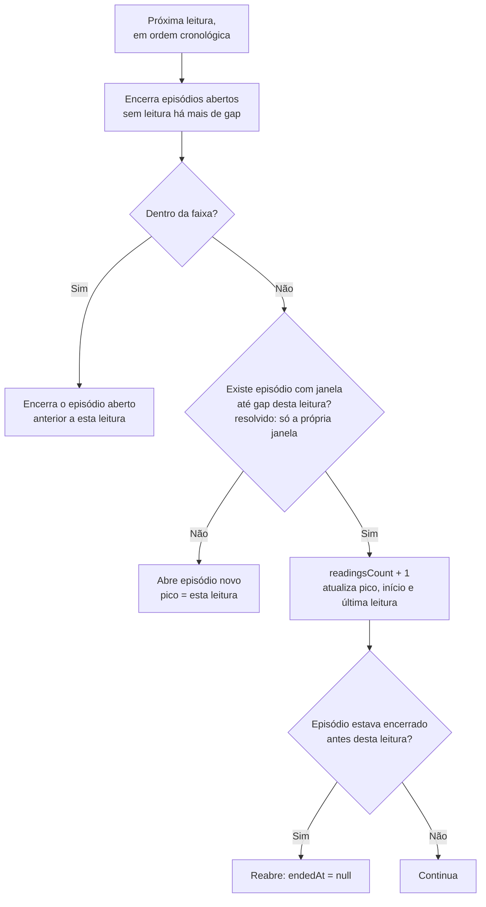
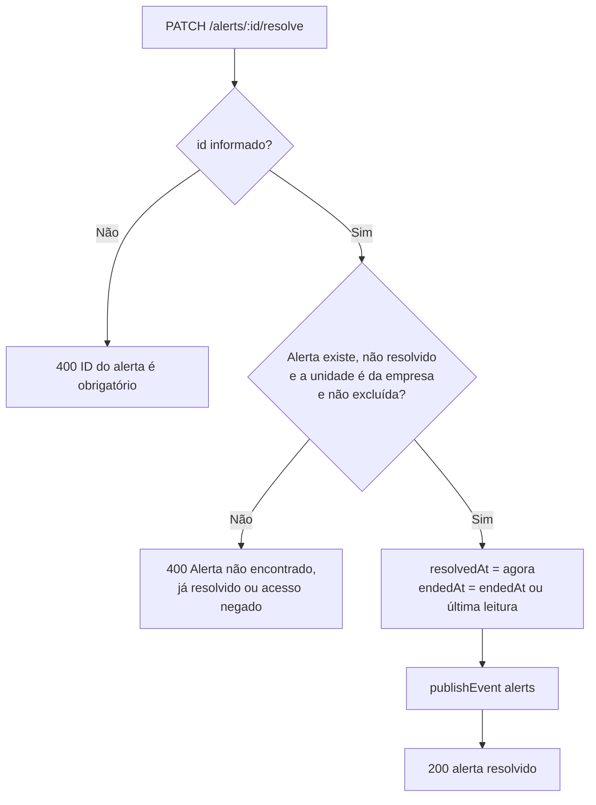

# 9. Alertas

Pastas e arquivos (em `api/src/`): `controllers/alert/`, `services/alert/`, `lib/temperatureAlerts.ts` e `jobs/detectOfflineDevices.ts`.

Um alerta é um **episódio**, não uma leitura isolada. Há dois tipos (`Alert.type`):

| Tipo | Quando abre | Quando encerra (`endedAt`) |
|---|---|---|
| `OUT_OF_RANGE` | Leitura fora dos limites da unidade | Leitura de volta à faixa, silêncio longo ou resolução pelo operador |
| `SENSOR_OFFLINE` | Placa vinculada sem enviar nada por mais de `SENSOR_OFFLINE_MINUTES` | A placa volta a se comunicar, é desvinculada/desativada ou a unidade é excluída |

`endedAt` (o episódio acabou) é diferente de `resolvedAt` (o operador tratou o alerta).

---

## 9.1 Episódios de temperatura — `planAlertEpisodes`

Regra de negócio central, em `src/lib/temperatureAlerts.ts`. É uma função **pura** (sem banco) que recebe os episódios existentes de uma placa numa unidade, as leituras novas, os limites e a janela `gapMs` (= `SENSOR_OFFLINE_MINUTES`, padrão 10 min).

As leituras podem chegar fora de ordem (store & forward), então quem decide é o **horário** de cada leitura, não a ordem de chegada. As leituras são processadas em ordem cronológica:

1. **Silêncio**: um episódio aberto cuja última leitura ficou mais de `gapMs` antes desta é encerrado na última leitura conhecida (não dá para saber quando a excursão acabou).
2. **Leitura dentro da faixa** (`min <= t <= max`): encerra o episódio aberto anterior a ela, no horário desta leitura.
3. **Leitura fora da faixa**: procura um episódio cuja janela `[início - gap, fim + gap]` contenha a leitura.
   - Achou: soma a leitura (`readingsCount + 1`), atualiza o pico se esta estiver mais distante dos limites, recua o início ou avança a última leitura se for o caso, e **reabre** o episódio se ele tinha sido encerrado antes desta leitura (oscilações curtas, como uma porta aberta duas vezes, ficam num alerta só).
   - Episódio **resolvido** pelo operador só aceita leituras dentro da própria janela `[início, fim]`: uma excursão que continua depois da resolução abre um **alerta novo**.
   - Não achou: abre um episódio novo.



Exemplo, limites 2 a 8 °C, gap de 10 min:

| Horário | Temperatura | Efeito |
|---|---|---|
| 10:00 | 9,1 | Abre episódio (pico 9,1) |
| 10:05 | 10,4 | Mesmo episódio, 2 leituras, pico 10,4 |
| 10:10 | 7,5 | Encerra o episódio às 10:10 |
| 10:14 | 9,0 | Volta a sair da faixa a menos de 10 min do fim: o mesmo episódio é reaberto |
| 10:40 | 9,3 | Sem leituras há 26 min: o episódio é encerrado às 10:14 e um novo é aberto |

### Aplicação no banco — `applyReadingsToAlerts`

Chamada dentro da transação (com `lockDevice`) pela ingestão e pelo vínculo de placas:

1. Busca os alertas `OUT_OF_RANGE` da unidade e da placa que estão abertos ou que encostam no período das leituras (± gap).
2. Roda `planAlertEpisodes`.
3. Grava só os episódios alterados: `update` nos existentes, `create` nos novos. A mensagem é refeita a partir do pico:
   ```
   ALERTA CRÍTICO: Temperatura chegou a 10.4°C. Limite era 2°C a 8°C. (ACIMA DO PERMITIDO)
   ```
4. Retorna quantos episódios foram abertos (para o log).

Leituras em quarentena não geram alerta até serem recuperadas num vínculo. Uma leitura repetida não é reinserida (índice único) e, por isso, não conta duas vezes no episódio.

---

## 9.2 Placa sem sinal — `DetectOfflineDevicesService`

Em cadeia fria, um sensor mudo é tão grave quanto temperatura alta. O job `detectOfflineDevices` roda na inicialização e **a cada 1 minuto**:

```mermaid
flowchart TD
    A[Vínculos ativos de placas ativas<br/>em unidades não excluídas] --> B[Para cada vínculo:<br/>último contato = maior entre<br/>lastSeenAt e início do vínculo]
    B --> C{Silêncio > SENSOR_OFFLINE_MINUTES?}
    C -- Sim --> D{Já existe alerta SENSOR_OFFLINE<br/>aberto para placa e unidade?}
    D -- Sim --> Z[Nada]
    D -- Não --> E{Já houve alerta desta queda<br/>startedAt >= último contato?<br/>ex.: resolvido pelo operador}
    E -- Sim --> Z
    E -- Não --> F[Cria SENSOR_OFFLINE<br/>startedAt = último contato<br/>PLACA SEM SINAL: MAC não envia dados desde ...]
    C -- Não --> G{Há alerta aberto?}
    G -- Sim --> H[Encerra: endedAt = último contato]
    G -- Não --> Z
    A --> S[Alertas abertos sem vínculo ativo<br/>correspondente]
    S --> T[Encerra: endedAt = agora]
    F & H & T --> EV[publishEvent alerts<br/>por empresa afetada]
```



- Uma placa recém-vinculada, ou que nunca falou, conta o silêncio a partir do início do vínculo.
- Resolver o alerta com a placa ainda muda não faz o job reabri-lo para a mesma queda.
- O fim do episódio fica no contato mais recente, no máximo 1 minuto (o intervalo do job) depois da volta.

---

## 9.3 Listar alertas — `GET /alerts`

`ListAlertsController` → `ListAlertsService`

**Query:**
| Parâmetro | Valores | Efeito |
|---|---|---|
| `status` | `pending` / `resolved` / ausente | `resolvedAt` nulo / não nulo / todos |
| `coldUnitId` | uuid | Filtra por unidade |
| `page` | inteiro ≥ 1 (padrão 1) | Página |
| `pageSize` | 1 a 100 (padrão 20) | Itens por página |

Isolamento: só alertas de unidades da empresa do token e não excluídas (`coldUnit: { enterpriseId, isDeleted: false }`).

Resposta:
```json
{
  "data": [
    {
      "id": "…", "type": "OUT_OF_RANGE", "message": "…",
      "temperature": 9.3, "peakTemperature": 10.4, "readingsCount": 3,
      "startedAt": "…", "lastReadingAt": "…", "endedAt": null, "resolvedAt": null,
      "createdAt": "…", "coldUnitId": "…", "deviceId": "…",
      "coldUnit": { "name": "Câmara 01", "type": "COLD_ROOM" },
      "device": { "macAddress": "24:6F:28:AA:BB:CC" }
    }
  ],
  "total": 37,
  "page": 1,
  "pageSize": 20
}
```

Ordenação: `createdAt` decrescente. A lista e o total são consultados em paralelo (`Promise.all`). `device` é nulo nos alertas anteriores aos episódios.

## 9.4 Resolver alerta — `PATCH /alerts/:id/resolve`

`ResolveAlertController` → `ResolveAlertService`

Qualquer usuário autenticado da empresa pode resolver.



- Resolver **também encerra o episódio**. Se a temperatura continuar fora da faixa, a próxima leitura abre um alerta novo, e o operador vê que o problema persiste.
- A mensagem de erro é genérica de propósito: não confirma se o id existe em outra empresa (proteção contra IDOR).
- O sistema não registra **quem** resolveu o alerta, só quando.
