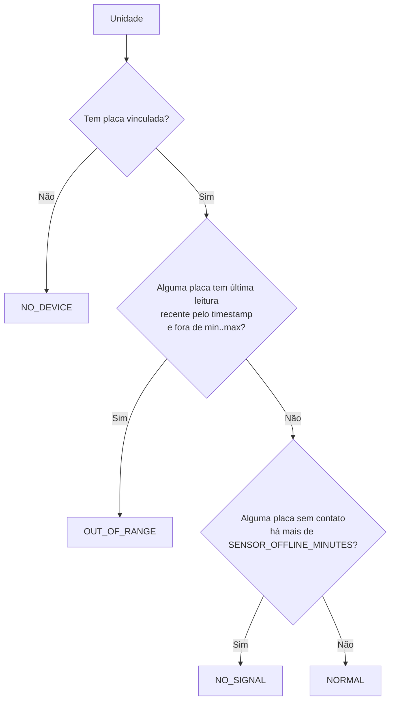
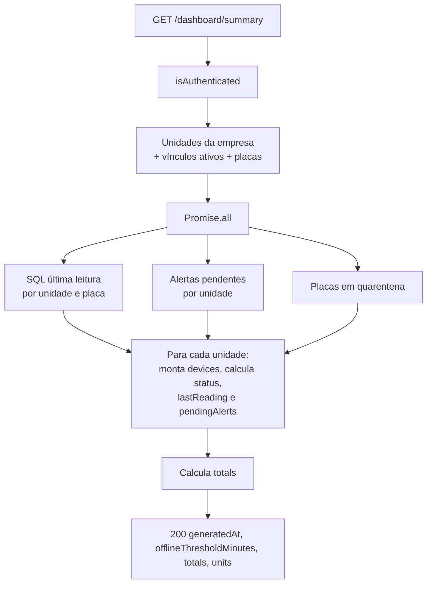

# 10. Dashboard — `GET /dashboard/summary`

Arquivos: `src/controllers/dashboard/GetDashboardSummaryController.ts`, `src/services/dashboard/GetDashboardSummaryService.ts`, `src/lib/deviceStatus.ts`.

Retorna, para a empresa do token, cada unidade fria com seu status atual, a última leitura, as placas vinculadas e os alertas pendentes, além de totais gerais.

## Coleta dos dados

1. Busca as unidades não excluídas da empresa, em ordem alfabética, com os vínculos ativos e as placas, incluindo o último contato de cada placa (`ColdUnitDevice.lastSeenAt`, gravado pela ingestão a cada mensagem aceita).
2. Em paralelo (`Promise.all`):
   - **Última leitura de cada placa em cada unidade** — SQL `DISTINCT ON (cold_unit_id, device_id) … ORDER BY timestamp DESC`. Olhar só a última leitura da unidade esconderia uma placa fora dos limites quando há várias placas.
   - **Alertas pendentes por unidade** (`groupBy coldUnitId` com `resolvedAt = null`), dos dois tipos: temperatura e placa sem sinal.
   - **Placas com quarentena não expirada** da empresa.

## Status da unidade



| Status | Significado |
|---|---|
| `NO_DEVICE` | Nenhuma placa vinculada |
| `OUT_OF_RANGE` | Pelo menos uma placa com última leitura recente fora da faixa. Tem prioridade sobre `NO_SIGNAL` |
| `NO_SIGNAL` | Pelo menos uma placa sem contato no prazo (basta uma silenciosa) |
| `NORMAL` | Todas as placas com contato recente e dentro da faixa |

"Recente" significa até `SENSOR_OFFLINE_MINUTES` (padrão 10 min). Para o `OUT_OF_RANGE` a idade é medida pelo `timestamp` (momento da medição), então uma leitura antiga fora da faixa não mantém a unidade em alerta para sempre. Para o `isOnline` da placa vale o `lastSeenAt` (hora de chegada da última mensagem), porque um envio store & forward, mesmo com leituras antigas ou repetidas, prova que a placa está viva.

O status `NO_SIGNAL` é calculado na hora da consulta. Em paralelo, o job de placas sem sinal abre um alerta `SENSOR_OFFLINE` com o mesmo critério (ver [Alertas](09-alertas.md)), e quando isso acontece o painel recebe um evento em tempo real.

## Resposta

```json
{
  "generatedAt": "2026-11-04T13:20:00.000Z",
  "offlineThresholdMinutes": 10,
  "totals": {
    "units": 5, "normal": 3, "outOfRange": 1, "noSignal": 1, "noDevice": 0,
    "pendingAlerts": 12,
    "quarantinedDevices": 2
  },
  "units": [
    {
      "id": "…", "name": "Câmara 01", "type": "COLD_ROOM",
      "minTemperature": 2, "maxTemperature": 8, "…": "demais campos da unidade",
      "status": "NORMAL",
      "lastReading": { "coldUnitId": "…", "deviceId": "…", "temperature": 4.1,
                       "sourceType": "REALTIME", "timestamp": "…" },
      "devices": [
        { "id": "…", "macAddress": "24:6F:28:AA:BB:CC", "lastSeenAt": "…",
          "isOnline": true, "lastReading": { "…": "…" } }
      ],
      "pendingAlerts": 0
    }
  ]
}
```

- `lastReading` da unidade é a mais recente entre as últimas leituras de suas placas.
- Os timestamps vindos do SQL são convertidos para texto UTC no banco e para `Date` no Node, para não depender do fuso da sessão.

## Fluxo completo


