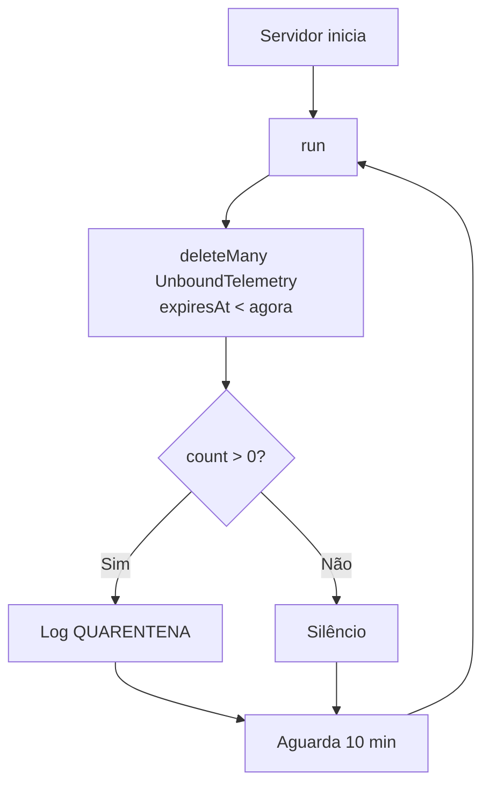
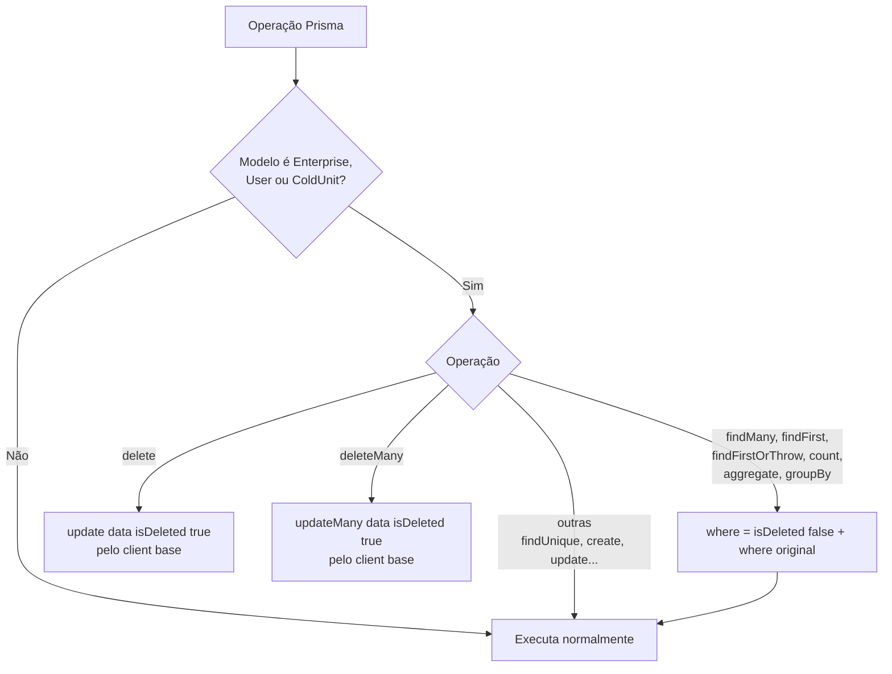

# 11. Jobs e soft delete

Os jobs rodam dentro do próprio processo da API, com `setInterval`, e são iniciados no `server.ts`. Cada execução captura os próprios erros e os registra no console sem derrubar o servidor.

| Job | Arquivo | Intervalo | Função |
|---|---|---|---|
| Limpeza da quarentena | `src/jobs/purgeExpiredTelemetry.ts` | 10 min | Apaga leituras expiradas da quarentena |
| Placas sem sinal | `src/jobs/detectOfflineDevices.ts` | 1 min | Abre e encerra alertas `SENSOR_OFFLINE` |

## 11.1 Limpeza da quarentena

Arquivos: `src/jobs/purgeExpiredTelemetry.ts`, `src/services/telemetry/PurgeExpiredTelemetryService.ts`.

1. Executa uma limpeza imediatamente e depois a cada **10 minutos**.
2. Cada execução apaga (exclusão física) os registros de `UnboundTelemetry` com `expiresAt < agora`.
3. Loga `[QUARENTENA] N leitura(s) expirada(s) descartada(s).` quando apaga algo.

Como o job roda a cada 10 minutos, uma leitura pode ficar até ~10 min além do prazo. Isso não afeta o sistema, porque `GET /devices/unbound`, o dashboard e o bind já ignoram registros com `expiresAt <= agora`.

## 11.2 Placas sem sinal

Arquivos: `src/jobs/detectOfflineDevices.ts`, `src/services/alert/DetectOfflineDevicesService.ts`. Executa na inicialização e a cada **1 minuto**. A regra completa está em [Alertas](09-alertas.md#92-placa-sem-sinal--detectofflinedevicesservice).

Os dois jobs são idempotentes: com várias instâncias da API, cada uma os executaria sem prejuízo de dados. O barramento de eventos, porém, é em memória (ver [Tempo real](14-tempo-real.md)).

## 11.3 Soft delete (exclusão lógica)

Arquivo: `src/lib/prisma.ts`.

`Enterprise`, `User` e `ColdUnit` têm a coluna `is_deleted`. Em vez de apagar, o sistema marca como excluído, preservando o histórico (leituras e alertas de uma unidade excluída continuam no banco). O cliente Prisma exportado é estendido com `$extends` para aplicar isso automaticamente:

### Limites da extensão

| Situação | Comportamento | Por quê / cuidado |
|---|---|---|
| `findUnique` | **Não filtra** | Proposital: as checagens de CNPJ e e-mail duplicados precisam enxergar registros excluídos, então CNPJ e e-mail nunca são reaproveitados |
| Filtros por relação e `include` | Não filtra | Ex.: `coldUnit: { enterpriseId }` em alertas precisa de `isDeleted: false` explícito, e os services fazem isso |
| `delete`/`deleteMany` dentro de `$transaction` | Roda **fora** da transação | A extensão usa o client base. Por isso `DeleteEnterpriseService` e `DeleteColdUnitService` usam `update`/`updateMany` com `isDeleted: true` dentro da transação |
| `isDeleted: false` explícito nos services | Redundante | A extensão já adiciona; mantido por clareza |

O mesmo cliente também omite `ColdUnitDevice.apiKeyHash` de todas as consultas (`omit`), para que o hash da chave da placa nunca apareça numa resposta.

### Efeitos de cada exclusão

| Entidade | Efeito |
|---|---|
| Empresa | Empresa, usuários e unidades marcados como excluídos; vínculos encerrados; placas desativadas ([Empresas](05-empresas.md)) |
| Usuário | Não consegue mais fazer login; e-mail continua reservado ([Usuários](04-usuarios.md)) |
| Unidade fria | Vínculos encerrados; placas voltam a mandar dados para a quarentena; alertas de sinal encerrados pelo job ([Unidades frias](06-unidades-frias.md)) |
| Placa | Não é excluída: é **desativada** (`isActive = false`) ([Placas](07-placas-e-vinculos.md)) |
