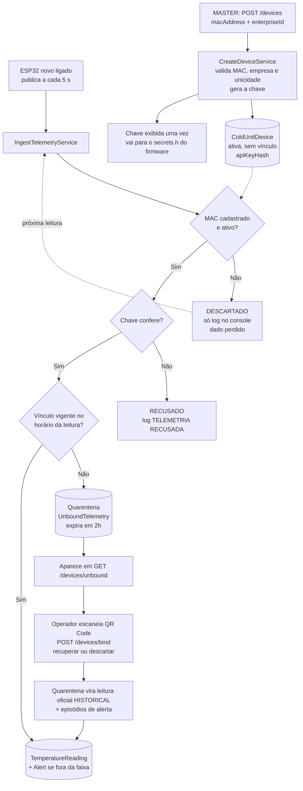
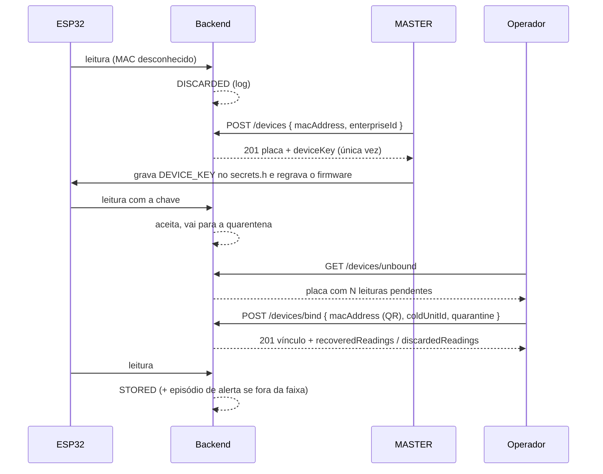

# 12. O que acontece quando chega uma leitura de uma placa desconhecida

## Resposta curta

**O sistema não cria a placa (`ColdUnitDevice`) automaticamente.** Uma leitura de um MAC que não está cadastrado (ou de uma placa desativada) é **descartada**: nada é gravado no banco, nem na quarentena. A placa só passa a existir quando um usuário **MASTER** a cadastra com `POST /devices`. Esse cadastro gera a **chave** que o firmware precisa para ter as leituras aceitas.

## O que o código faz

Em `api/src/services/telemetry/IngestTelemetryService.ts`:

```ts
// 1. Placas não cadastradas ou desativadas têm os dados descartados
const device = await prisma.coldUnitDevice.findUnique({
  where: { macAddress: normalizedMac },
  omit: { apiKeyHash: false }
});

if (!device || !device.isActive) {
  console.warn(`[TELEMETRIA DESCARTADA] Placa desconhecida ou inativa: ${normalizedMac}`);
  return { status: 'DISCARDED' as const };
}

// 2. O MAC está impresso no QR Code: só a chave prova que a mensagem veio da placa
if (!verifyDeviceKey(deviceKey, device.apiKeyHash)) {
  console.warn(`[TELEMETRIA RECUSADA] Chave inválida para a placa ${normalizedMac}`);
  return { status: 'UNAUTHORIZED' as const };
}
```

Passo a passo:
1. Antes de chegar à API, a mensagem MQTT já precisa passar pelo broker: a placa entra com a conta compartilhada das placas e só pode publicar em `coldchain/devices/#`.
2. O MAC (vindo do tópico MQTT ou do corpo HTTP) é normalizado (`AA:BB:CC:DD:EE:FF`). As leituras são validadas: de 1 a 500, todas com temperatura numérica.
3. O service procura a placa pelo MAC. Se não existir ou estiver inativa:
   - escreve `[TELEMETRIA DESCARTADA] Placa desconhecida ou inativa: <MAC>` no console do servidor;
   - retorna `DISCARDED` sem gravar nada e **sem atualizar** nenhum "visto por último".
4. Se a placa existe mas a chave não confere (ou ela ainda não tem chave), retorna `UNAUTHORIZED` com o log `[TELEMETRIA RECUSADA]`.
5. O retorno depende do canal:
   - **MQTT** (caso normal do ESP32): só o log. A placa publica em QoS 0, não recebe nenhum aviso e continua publicando a cada 5 s.
   - **HTTP** `POST /telemetry/readings`: `404 { "error": "Placa não cadastrada ou desativada." }` ou `401 { "error": "Chave da placa inválida." }`.

## Como a placa passa a ser aceita



A placa passa por quatro estágios:

| Estágio | Condição | Destino das leituras |
|---|---|---|
| Desconhecida | MAC não cadastrado | **Descartadas** |
| Cadastrada, firmware sem a chave certa | `POST /devices` feito, `DEVICE_KEY` errada ou ausente | **Recusadas** |
| Cadastrada, sem vínculo | Chave certa, sem `bind` | Quarentena (por até `QUARANTINE_TTL_HOURS`, padrão 2 h) |
| Vinculada | `POST /devices/bind` feito | Leituras oficiais e alertas |

## Sequência típica de instalação



Na prática, a ordem natural é cadastrar a placa **antes** de gravar o firmware, porque a chave só existe depois do cadastro.

## Consequências e por que funciona assim

- **Segurança**: o cadastro prévio funciona como lista de permissão, e a chave impede que alguém que conheça o MAC (impresso no QR Code) envie dados falsos em nome da placa. Criar placas automaticamente abriria espaço para qualquer dispositivo com a senha do broker encher o banco.
- **Propriedade**: a placa precisa pertencer a uma empresa (`enterpriseId` obrigatório). Uma leitura não traz essa informação, então não daria para criar a placa automaticamente sem saber de quem ela é.
- **Perda de dados**: o que a placa envia antes do cadastro (ou com a chave errada) é perdido. O store & forward do firmware não ajuda, porque o ESP32 só guarda dados na flash quando está **sem conexão com o broker**; conectado, publica em QoS 0 e considera o envio concluído, mesmo que a API descarte.
- **Visibilidade**: placas desconhecidas não aparecem em nenhuma tela, só no console do servidor. `GET /devices/unbound` lista apenas placas cadastradas.

## Possível melhoria (não implementada)

Registrar MACs desconhecidos numa tabela de "placas pendentes de aprovação", para o MASTER vê-los e cadastrá-los pelo painel. Como a chave só existe depois do cadastro, as primeiras leituras continuariam sem poder ser autenticadas e não poderiam virar dados oficiais.
