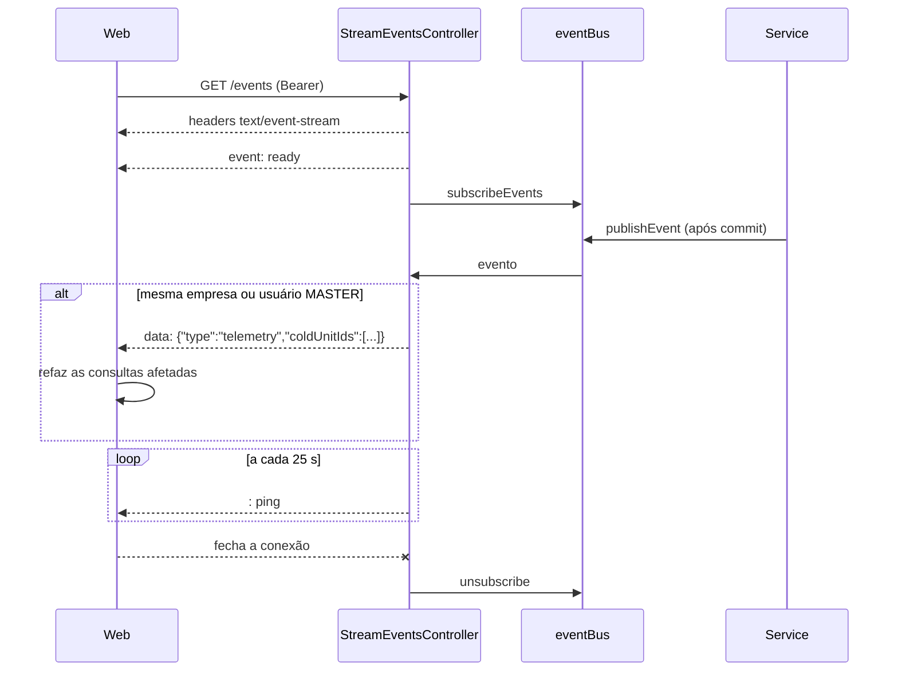

# 14. Tempo real — `GET /events`

Arquivos (em `api/src/`): `lib/eventBus.ts` e `controllers/events/StreamEventsController.ts`.

As telas abertas do painel recebem um aviso sempre que chegam leituras ou mudam alertas e placas, sem precisar consultar a API repetidamente.

## Barramento de eventos (`eventBus`)

Um `EventEmitter` do Node, em memória. Os services chamam `publishEvent` **depois do commit** da transação, para que quem recebe o aviso e busca os dados já os encontre.

```ts
type LiveEventType = 'telemetry' | 'alerts' | 'devices';

interface LiveEvent {
  type: LiveEventType;
  enterpriseId: string;
  coldUnitIds?: string[];
}
```

| Tipo | Publicado por | Quando |
|---|---|---|
| `telemetry` | `IngestTelemetryService` | Toda mensagem aceita, com as unidades que receberam leituras |
| `alerts` | `ResolveAlertService`, `DetectOfflineDevicesService` | Alerta resolvido; alerta de placa sem sinal aberto ou encerrado |
| `devices` | `BindDeviceService`, `UnbindDeviceService`, `DeactivateDeviceService` | Vínculo criado, encerrado ou placa desativada |

Os eventos só dizem **o que mudou**, sem os dados. A tela busca de novo pelas rotas de sempre, e o cálculo do painel continua num lugar só (`GET /dashboard/summary`).

## Stream — `GET /events` (autenticado)

Server-Sent Events: o navegador mantém uma conexão HTTP aberta e recebe uma linha a cada evento. O web lê o stream com `fetch` (e não com `EventSource`) para poder enviar o header `Authorization: Bearer`.



1. Envia os headers `Content-Type: text/event-stream`, `Cache-Control: no-cache, no-transform`, `Connection: keep-alive` e `X-Accel-Buffering: no` (evita buffer em proxies como o nginx).
2. Envia `event: ready`; o web usa esse sinal para reduzir o polling periódico, que fica como reserva.
3. Repassa os eventos filtrados por empresa: usuários comuns só recebem os da própria empresa; o MASTER recebe todos.
4. Envia um comentário `: ping` a cada 25 s para que proxies não fechem a conexão ociosa.
5. Ao fechar a conexão, para o heartbeat e cancela a inscrição.

## Limitação

Por ser em memória, o barramento só funciona com **uma instância** da API: um evento publicado numa instância não chega às telas conectadas em outra. Para escalar, a troca seria por Redis pub/sub ou `LISTEN/NOTIFY` do PostgreSQL, mantendo a mesma interface `publishEvent`/`subscribeEvents`.
