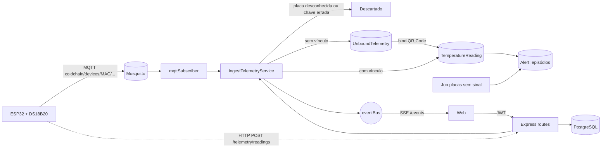

# ColdChain API — Documentação do Backend

API REST de monitoramento da cadeia de frio. Placas ESP32 com sensor DS18B20 medem a temperatura de câmaras frias, frigoríficos e caminhões refrigerados e enviam as leituras ao backend via MQTT (ou HTTP). O backend associa cada leitura à unidade monitorada, agrupa as temperaturas fora dos limites em episódios de alerta, detecta placas sem sinal e avisa o painel web (`../../web`) em tempo real.

O código fica em `api/` neste monorepo; o firmware, em `firmware/`. A visão geral do sistema está em [`../ARQUITETURA.md`](../ARQUITETURA.md).

## Stack

| Camada | Tecnologia |
|---|---|
| Servidor HTTP | Express 5 (Node.js, ESM, TypeScript executado com `tsx`) |
| Banco de dados | PostgreSQL 16 (Docker) |
| ORM | Prisma 7 com adaptador `@prisma/adapter-pg` |
| Mensageria IoT | MQTT: broker Mosquitto próprio (Docker), com usuário, senha e ACL |
| Autenticação | JWT para usuários; chave por placa (SHA-256) para o hardware |
| Tempo real | Server-Sent Events (`GET /events`) |
| Hardware | ESP32 + DS18B20, firmware em `firmware/` |

## Índice

| # | Documento | Conteúdo |
|---|---|---|
| 1 | [Arquitetura](01-arquitetura.md) | Camadas, inicialização do servidor, broker, padrões de código |
| 2 | [Modelo de dados](02-modelo-de-dados.md) | Entidades, relações, índices, diagrama ER |
| 3 | [Autenticação e permissões](03-autenticacao-e-permissoes.md) | Login, JWT, chave da placa, papéis, multiempresa |
| 4 | [Usuários](04-usuarios.md) | Perfil próprio, troca de senha, CRUD de usuários |
| 5 | [Empresas](05-empresas.md) | CRUD de empresas (MASTER) |
| 6 | [Unidades frias](06-unidades-frias.md) | CRUD de câmaras/caminhões e histórico de placas |
| 7 | [Placas e vínculos](07-placas-e-vinculos.md) | Cadastro de ESP32, chave, vínculo por QR Code, desvínculo, desativação |
| 8 | [Telemetria](08-telemetria.md) | Ingestão HTTP/MQTT, lotes, quarentena, store & forward, consultas |
| 9 | [Alertas](09-alertas.md) | Episódios de temperatura, placa sem sinal, listagem e resolução |
| 10 | [Dashboard](10-dashboard.md) | Resumo de status das unidades |
| 11 | [Jobs e soft delete](11-jobs-e-soft-delete.md) | Limpeza da quarentena, detecção de placas sem sinal, exclusão lógica |
| 12 | [Leitura de placa desconhecida](12-placa-desconhecida.md) | O que acontece quando chega dado de um MAC não cadastrado |
| 13 | [Limitações conhecidas](13-limitacoes-conhecidas.md) | Pontos incompletos e riscos |
| 14 | [Tempo real](14-tempo-real.md) | Eventos para as telas abertas (SSE) |

## Mapa de rotas

| Método | Rota | Middlewares | Quem pode |
|---|---|---|---|
| GET | `/health` | — | Público (estado do banco e do MQTT) |
| POST | `/login` | — | Público |
| POST | `/telemetry/readings` | — (header `X-Device-Key`) | Placa com chave válida |
| GET | `/me` | isAuthenticated | Todos |
| PUT | `/me` | isAuthenticated | Todos |
| PUT | `/me/password` | isAuthenticated | Todos |
| GET | `/dashboard/summary` | isAuthenticated | Todos |
| POST | `/enterprises` | isAuthenticated, isMaster | MASTER |
| GET | `/enterprises` | isAuthenticated, isMaster | MASTER |
| GET | `/enterprises/:id` | isAuthenticated | MASTER (qualquer) / demais (só a própria) |
| PUT | `/enterprises/:id` | isAuthenticated, isMaster | MASTER |
| DELETE | `/enterprises/:id` | isAuthenticated, isMaster | MASTER |
| POST | `/users` | isAuthenticated, isAdmin | ADMIN, MASTER |
| GET | `/users` | isAuthenticated, isAdmin | ADMIN, MASTER |
| PUT | `/users/:id` | isAuthenticated, isAdmin | ADMIN, MASTER |
| DELETE | `/users/:id` | isAuthenticated, isAdmin | ADMIN, MASTER |
| POST | `/cold-units` | isAuthenticated, isAdmin | ADMIN, MASTER |
| GET | `/cold-units` | isAuthenticated | Todos |
| GET | `/cold-units/:id` | isAuthenticated | Todos |
| PUT | `/cold-units/:id` | isAuthenticated, isAdmin | ADMIN, MASTER |
| DELETE | `/cold-units/:id` | isAuthenticated, isAdmin | ADMIN, MASTER |
| GET | `/cold-units/:id/associations` | isAuthenticated | Todos |
| POST | `/devices` | isAuthenticated, isMaster | MASTER |
| GET | `/devices` | isAuthenticated | Todos |
| GET | `/devices/unbound` | isAuthenticated | Todos |
| POST | `/devices/bind` | isAuthenticated | Todos |
| POST | `/devices/:id/unbind` | isAuthenticated | Todos |
| PATCH | `/devices/:id/deactivate` | isAuthenticated, isMaster | MASTER |
| GET | `/devices/:id/associations` | isAuthenticated | Todos |
| POST | `/devices/:id/key` | isAuthenticated, isMaster | MASTER |
| GET | `/cold-units/:coldUnitId/readings` | isAuthenticated | Todos |
| GET | `/cold-units/:coldUnitId/readings/series` | isAuthenticated | Todos |
| GET | `/alerts` | isAuthenticated | Todos |
| PATCH | `/alerts/:id/resolve` | isAuthenticated | Todos |
| GET | `/events` | isAuthenticated | Todos |

## Como executar

```bash
cd api
cp .env.example .env        # ajuste senhas e segredos
docker compose up -d        # PostgreSQL 16 (porta 5433) e Mosquitto (1883)
npm install
npx prisma generate         # gera o cliente (o postinstall não gera)
npx prisma migrate dev      # aplica as migrations
npx prisma db seed          # cria a empresa base e o usuário MASTER
npm run dev                 # tsx watch src/server.ts
```

Em produção: `npm run build` (gera o cliente Prisma e compila para `dist/`), `npm run migrate:deploy` e `npm start`. O passo a passo da publicação (Render, Supabase e EMQX Cloud Serverless) está em [DEPLOY.md](../DEPLOY.md).

`GET /health` é público e responde `{ status, database, mqtt }`: `200` com o banco no ar (`status` é `ok` ou, sem MQTT, `degraded`) e `503` sem banco.

Variáveis do `.env`:

| Variável | Obrigatória | Uso |
|---|---|---|
| `DATABASE_URL` | Sim | Conexão com o PostgreSQL |
| `PORT` | Não (padrão 3334) | Porta HTTP |
| `NODE_ENV` | Não | `production` torna obrigatórios os itens marcados com "Produção" e recusa valores do `.env.example` |
| `POSTGRES_USER` / `POSTGRES_PASSWORD` / `POSTGRES_DB` | Sim (docker compose) | Criam o banco no container; `DATABASE_URL` usa os mesmos valores |
| `JWT_SECRET` | Sim | Assinatura dos tokens. Em produção, pelo menos 32 caracteres (`openssl rand -base64 48`) |
| `MQTT_BROKER_URL` | Produção (padrão `mqtt://localhost:1883`) | Broker MQTT |
| `MQTT_USERNAME` / `MQTT_PASSWORD` | Sim | Conta da API no broker (só leitura) |
| `MQTT_DEVICE_USERNAME` / `MQTT_DEVICE_PASSWORD` | Sim | Conta compartilhada das placas no broker (só publicação) |
| `MQTT_CLIENT_ID` | Não (padrão `coldchain-api`) | Id fixo da sessão persistente da API no broker |
| `QUARANTINE_TTL_HOURS` | Não (padrão 2) | Validade dos dados em quarentena |
| `SENSOR_OFFLINE_MINUTES` | Não (padrão 10) | Silêncio que deixa a placa offline e intervalo que separa episódios de alerta |
| `CORS_ORIGINS` | Produção (padrão `http://localhost:5173`) | Origens permitidas, separadas por vírgula |
| `TRUST_PROXY` | Não | Número de proxies reversos à frente da API (ex.: `1`), para o limite de requisições ver o IP do cliente |
| `SEED_MASTER_EMAIL` / `SEED_MASTER_PASSWORD` | Só no seed | MASTER criado pelo seed; senha com pelo menos 8 caracteres |
| `SEED_MASTER_NAME` | Não (padrão `Administrador`) | Nome do MASTER criado pelo seed |

O seed (`prisma/seed.ts`) cria, de forma idempotente (`upsert`), a empresa **CTech - Cold Chain Logistics** (CNPJ `00000000000191`) e o usuário MASTER com `SEED_MASTER_EMAIL` e `SEED_MASTER_PASSWORD` do `.env`. Ele recusa senhas com menos de 8 caracteres ou iguais à do exemplo. Se o e-mail já existir, nada é alterado; troque a senha pela tela de perfil.

## Visão geral do fluxo


